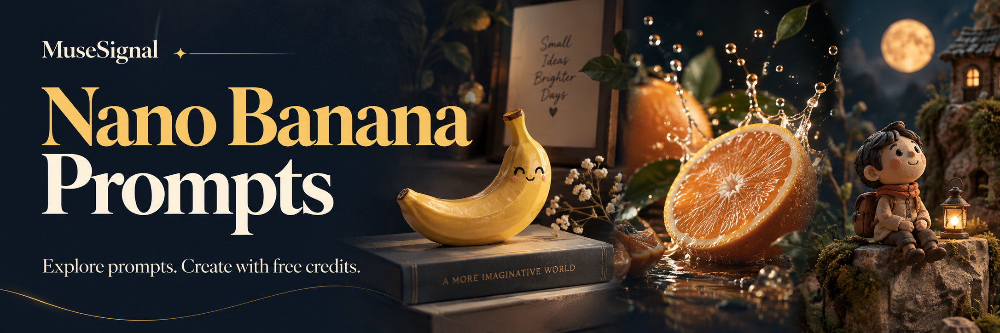

[](https://musesignal.com/?utm_source=github&utm_medium=repository&utm_campaign=awesome-nano-banana-prompts&utm_content=banner)

# Awesome Nano Banana Prompts

**by [MuseSignal](https://musesignal.com/?utm_source=github&utm_medium=repository&utm_campaign=awesome-nano-banana-prompts&utm_content=brand)**

[English](README.md) · [简体中文](README.zh-CN.md)

Complete prompts, real example images, original creators and sources. Curated by MuseSignal for product photography, portraits, posters and more.

**Nano Banana · Nano Banana 2 · Nano Banana Pro**

> **Try leading AI image models — no top-up required to get started.**
>
> Sign up and claim free credits on MuseSignal. Generation uses credits; usage varies by model and settings.

**[Start creating with free credits](<https://musesignal.com/?utm_source=github&utm_medium=repository&utm_campaign=awesome-nano-banana-prompts&utm_content=hero>) · [Explore selected prompts ↓](<#selected-prompts>)**

| Public prompts in this repository | Complete examples on this page | Dataset updated |
| ---: | ---: | --- |
| **239** | **60** | 2026-10-14 |

This repository shares a selection from MuseSignal. The counts distinguish JSON records from examples on this page, not the full website library. Model collections are subsets of the catalog.

## Browse by use case

Open a filtered MuseSignal gallery. Counts refer to this repository's JSON; model collections offer separate version filters.

| Browse by use case | In JSON | MuseSignal |
| --- | ---: | --- |
| Portrait | 117 | [Nano Banana](<https://musesignal.com/?category=portrait&model=nano-banana&utm_source=github&utm_medium=repository&utm_campaign=awesome-nano-banana-prompts&utm_content=category_portrait>) · [Nano Banana 2](<https://musesignal.com/?category=portrait&model=nano-banana-2&utm_source=github&utm_medium=repository&utm_campaign=awesome-nano-banana-prompts&utm_content=category_portrait>) · [Nano Banana Pro](<https://musesignal.com/?category=portrait&model=nano-banana-pro&utm_source=github&utm_medium=repository&utm_campaign=awesome-nano-banana-prompts&utm_content=category_portrait>) |
| Commercial &amp; Product | 43 | [Nano Banana](<https://musesignal.com/?category=commercial-product&model=nano-banana&utm_source=github&utm_medium=repository&utm_campaign=awesome-nano-banana-prompts&utm_content=category_commercial-product>) · [Nano Banana 2](<https://musesignal.com/?category=commercial-product&model=nano-banana-2&utm_source=github&utm_medium=repository&utm_campaign=awesome-nano-banana-prompts&utm_content=category_commercial-product>) · [Nano Banana Pro](<https://musesignal.com/?category=commercial-product&model=nano-banana-pro&utm_source=github&utm_medium=repository&utm_campaign=awesome-nano-banana-prompts&utm_content=category_commercial-product>) |
| Poster &amp; Graphic | 20 | [Nano Banana](<https://musesignal.com/?category=poster-graphic&model=nano-banana&utm_source=github&utm_medium=repository&utm_campaign=awesome-nano-banana-prompts&utm_content=category_poster-graphic>) · [Nano Banana 2](<https://musesignal.com/?category=poster-graphic&model=nano-banana-2&utm_source=github&utm_medium=repository&utm_campaign=awesome-nano-banana-prompts&utm_content=category_poster-graphic>) · [Nano Banana Pro](<https://musesignal.com/?category=poster-graphic&model=nano-banana-pro&utm_source=github&utm_medium=repository&utm_campaign=awesome-nano-banana-prompts&utm_content=category_poster-graphic>) |
| Food &amp; Drink | 12 | [Nano Banana](<https://musesignal.com/?category=food-drink&model=nano-banana&utm_source=github&utm_medium=repository&utm_campaign=awesome-nano-banana-prompts&utm_content=category_food-drink>) · [Nano Banana 2](<https://musesignal.com/?category=food-drink&model=nano-banana-2&utm_source=github&utm_medium=repository&utm_campaign=awesome-nano-banana-prompts&utm_content=category_food-drink>) · [Nano Banana Pro](<https://musesignal.com/?category=food-drink&model=nano-banana-pro&utm_source=github&utm_medium=repository&utm_campaign=awesome-nano-banana-prompts&utm_content=category_food-drink>) |
| Character &amp; Art | 29 | [Nano Banana](<https://musesignal.com/?category=character-art&model=nano-banana&utm_source=github&utm_medium=repository&utm_campaign=awesome-nano-banana-prompts&utm_content=category_character-art>) · [Nano Banana 2](<https://musesignal.com/?category=character-art&model=nano-banana-2&utm_source=github&utm_medium=repository&utm_campaign=awesome-nano-banana-prompts&utm_content=category_character-art>) · [Nano Banana Pro](<https://musesignal.com/?category=character-art&model=nano-banana-pro&utm_source=github&utm_medium=repository&utm_campaign=awesome-nano-banana-prompts&utm_content=category_character-art>) |
| Scene &amp; Space | 18 | [Nano Banana](<https://musesignal.com/?category=scene-space&model=nano-banana&utm_source=github&utm_medium=repository&utm_campaign=awesome-nano-banana-prompts&utm_content=category_scene-space>) · [Nano Banana 2](<https://musesignal.com/?category=scene-space&model=nano-banana-2&utm_source=github&utm_medium=repository&utm_campaign=awesome-nano-banana-prompts&utm_content=category_scene-space>) · [Nano Banana Pro](<https://musesignal.com/?category=scene-space&model=nano-banana-pro&utm_source=github&utm_medium=repository&utm_campaign=awesome-nano-banana-prompts&utm_content=category_scene-space>) |

<a id="selected-prompts"></a>

## Selected prompts: examples & complete text

[Portrait](<#selected-portrait>) · [Commercial &amp; Product](<#selected-commercial-product>) · [Poster &amp; Graphic](<#selected-poster-graphic>) · [Food &amp; Drink](<#selected-food-drink>) · [Character &amp; Art](<#selected-character-art>) · [Scene &amp; Space](<#selected-scene-space>)

Expand Full prompt to copy the original text. Try on MuseSignal opens the case; use its prompt action to open the creation workspace. Images are the original creators’ examples, and model versions retain their source attribution.

<a id="selected-portrait"></a>

### Portrait · 18

[Nano Banana](<https://musesignal.com/?category=portrait&model=nano-banana&utm_source=github&utm_medium=repository&utm_campaign=awesome-nano-banana-prompts&utm_content=category_portrait>) · [Nano Banana 2](<https://musesignal.com/?category=portrait&model=nano-banana-2&utm_source=github&utm_medium=repository&utm_campaign=awesome-nano-banana-prompts&utm_content=category_portrait>) · [Nano Banana Pro](<https://musesignal.com/?category=portrait&model=nano-banana-pro&utm_source=github&utm_medium=repository&utm_campaign=awesome-nano-banana-prompts&utm_content=category_portrait>)

<a id="prompt-3336e049-b5ee-454c-9e52-15918181db5b"></a>

#### Sadie Sink with Disco Ball in Pink

<a href="https://musesignal.com/prompt/3336e049-b5ee-454c-9e52-15918181db5b?utm_source=github&amp;utm_medium=repository&amp;utm_campaign=awesome-nano-banana-prompts&amp;utm_content=case_image"></a>

**Nano Banana Pro** · Creator: manolya

Use case: Portrait

<details>
<summary>Full prompt</summary>

```text
Disco Ball and Sadie Sink
Pink Aesthetic Nano Banana Pro:
{
"style_summary": "Retro-modern disco-pop aesthetic with high-saturation monochromatic tones.",
"pose": {
"orientation": "Over-the-shoulder look",
"description": "The subject is positioned with her back to the camera, twisting her torso to look back. She is holding a large silver disco ball at chest height, creating a focal point in the upper half of the frame.",
"stance": "High-cut silhouette emphasizing the hips and back."
},
"colors": {
"primary_palette": ["Bubblegum Pink", "Fuchsia", "Hot Pink"],
"accent_colors": ["Metallic Silver", "White"],
"skin_tones": "Warm, natural tan with highlights",
"vibe": "Monochromatic and high-energy."
},
"composition": {
"framing": "Vertical, medium-full shot",
"subject_placement": "Centered silhouette",
"background": "Minimalist, solid-colored flat wall",
"depth": "Shallow, with a sharp drop-off shadow on the background to create a 3D pop effect."
},
"outfits_and_props": {
"clothing": "High-leg pink spandex bodysuit with white piping/trim",
"accessories": "Rose-tinted transparent aviator-style sunglasses",
"key_prop": "A large, multi-faceted metallic silver disco ball",
"hair": "High ponytail, sleek and brunette."
},
"lighting": {
"type": "Hard studio lighting",
"direction": "Side-lit from the left",
"shadows": "Sharp, defined shadows on the wall and body contours",
"highlights": "Specular highlights on the bodysuit and disco ball facets",
"special_lighting": "Caustic light reflections (small squares of light) projected onto the subject's skin from the disco ball."
},
"effects_and_texture": {
"finish": "Glossy and high-contrast",
"texture": "Reflective surfaces (disco ball), matte background, and smooth spandex sheen",
"saturation": "High",
"grain": "Clean, digital finish with minimal noise."
```

</details>

**[Try on MuseSignal →](<https://musesignal.com/prompt/3336e049-b5ee-454c-9e52-15918181db5b?utm_source=github&utm_medium=repository&utm_campaign=awesome-nano-banana-prompts&utm_content=readme_case_cta>)** · [Original post](<https://x.com/manolyaai/status/2020561374217126145>)

---

<a id="prompt-e9496853-ff93-4817-a020-032fe8285cb3"></a>

#### Sweet Costume, Powerful Aura

<a href="https://musesignal.com/prompt/e9496853-ff93-4817-a020-032fe8285cb3?utm_source=github&amp;utm_medium=repository&amp;utm_campaign=awesome-nano-banana-prompts&amp;utm_content=case_image"></a>

**Nano Banana Pro** · Creator: manolya

Use case: Portrait

<details>
<summary>Full prompt</summary>

```text
{
"visual_style": {
"pose": {
"action": "Relaxed reclining on a textured surface",
"leg_position": "One leg gently raised and extended, the other comfortably bent",
"interaction": "Hands resting naturally on clothing or adjusting fabric casually",
"expression": "Soft, calm expression looking downward or sideways"
},
"colors": {
"palette": "Monochromatic Pink and White",
"primary": "#E18982 (Dusty Rose background)",
"secondary": "#F4A7B9 (Pastel Pink faux fur)",
"accents": [
"#FFFFFF (White clothing and accessories)",
"#F2DADA (Neutral skin tone balance)"
]
},
"composition": {
"framing": "Wide shot with significant negative space at the top",
"subject_placement": "Centered horizontally, weighted in the lower half of the frame",
"depth": "Layered textures with foreground and midground dominated by soft fur texture",
"angle": "Eye-level to slightly high-angle"
},
"outfits": {
"clothing": "White fashion bodysuit or fitted studio outfit (non-lingerie)",
"legwear": "Opaque or semi-opaque white tights or stockings",
"accessories": "Plush white bunny ear headband (playful fashion styling)",
"makeup": "Soft monochromatic pink tones on eyes and cheeks"
},
"lighting": {
"type": "High-key studio lighting",
"quality": "Soft and diffused with minimal harsh shadows",
"effect": "Even illumination emphasizing texture and color harmony"
},
"mood_and_style": {
"theme": "Playful Editorial, Whimsical Fashion",
"vibe": "Dreamy, lighthearted, soft, magazine-style",
"textures": "Contrast between smooth fabric and soft faux fur"
},
"environment": {
"setting": "Minimalist studio",
"props": "Large oversized pink faux-fur sofa or seating surface",
"background": "Solid seamless paper backdrop"
```

</details>

**[Try on MuseSignal →](<https://musesignal.com/prompt/e9496853-ff93-4817-a020-032fe8285cb3?utm_source=github&utm_medium=repository&utm_campaign=awesome-nano-banana-prompts&utm_content=readme_case_cta>)** · [Original post](<https://x.com/manolyaai/status/2021333957594243367>)

---

<a id="prompt-cf27f8fd-9c22-4325-9185-6283d1bc76ea"></a>

#### Seated Portrait with Foreground Emphasis

<a href="https://musesignal.com/prompt/cf27f8fd-9c22-4325-9185-6283d1bc76ea?utm_source=github&amp;utm_medium=repository&amp;utm_campaign=awesome-nano-banana-prompts&amp;utm_content=case_image"></a>

**Nano Banana 2** · Creator: sammy

Use case: Portrait

<details>
<summary>Full prompt</summary>

```text
{
"image_metadata": {
"style": "hyper-realistic smartphone photography",
"aspect_ratio": "4:5 vertical",
"resolution": "high resolution with subtle smartphone compression",
"camera": {
"device": "modern smartphone",
"lens": "wide-angle (~24mm equivalent)",
"angle": "slightly low, close perspective",
"framing": "full body seated portrait with strong foreground emphasis on legs and feet",
"focus": "sharp on face and foreground feet, mild background softness"
}
},
"subject": {
"use_reference_image": true,
"override": false,
"pose": {
"position": "seated deep into a cushioned armchair",
"torso": "slightly reclined into the backrest",
"legs": "both legs lifted and bent upward toward camera, creating strong foreshortening",
"arms": "wrapped casually around shins, holding legs in place",
"hips_and_glutes": {
"visibility": "partially visible",
"description": "subtle outline visible due to seated compression against chair cushion; fabric slightly stretched and creased around hip area",
"interaction_with_chair": "pressed into seat, creating natural flattening and fabric tension"
},
"feet": {
"position": "dominant foreground element, closest to lens",
"orientation": "soles facing camera at slight angles",
"detail": "natural skin texture, visible creases, relaxed toes"
}
},
"face": {
"expression": "neutral, slightly serious/pensive",
"gaze": "direct eye contact with camera"
}
},
"clothing": {
"type": "casual loungewear set",
"top": {
"item": "sweatshirt",
"color": "light grey",
"fit": "loose, slightly oversized",
"fabric_behavior": "soft folds around torso and arms"
},
"bottom": {
"item": "jogger sweatpants",
"color": "light grey",
"fit": "relaxed but slightly fitted around hips and thighs",
"details": "elastic ankle cuffs, visible creases from bent legs and seated compression"
}
},
"environment": {
"setting": "indoor, calm living space",
"chair": {
"type": "armchair",
"material": "brown leather",
"texture": "soft, slightly worn with natural creases",
"design": "rounded backrest with stitched geometric/sunburst pattern"
},
"background": {
"curtains": {
"color": "beige",
"material": "heavy fabric",
"style": "full-length, softly draped"
},
"floor": {
"type": "light patterned rug",
"visibility": "partially visible at bottom edge"
}
}
},
"lighting": {
"type": "natural daylight",
"source": "window from side/front",
"quality": "soft and diffused",
"shadow_behavior": "gentle shadows, no harsh contrast",
"tone": "warm-neutral"
},
"composition": {
"perspective": "strong foreshortening due to legs extending toward camera",
"focus_hierarchy": [
"feet in foreground",
"face and expression",
"body posture including seated compression"
],
"framing": "subject centered within chair",
"mood": "intimate, relaxed, candid"
},
"color_palette": {
"dominant": ["light grey", "warm brown", "beige"],
"secondary": ["neutral tones"],
"style": "muted, soft, warm"
},
"post_processing": {
"editing": "minimal, natural",
"contrast": "low to medium",
"saturation": "slightly muted",
"skin_retention": "realistic texture preserved"
```

</details>

**[Try on MuseSignal →](<https://musesignal.com/prompt/cf27f8fd-9c22-4325-9185-6283d1bc76ea?utm_source=github&utm_medium=repository&utm_campaign=awesome-nano-banana-prompts&utm_content=readme_case_cta>)** · [Original post](<https://x.com/sumiturkude007/status/2045917845842776100>)

---

<a id="prompt-f5935f6b-d62f-4cb5-a133-8cc9087a1c24"></a>

#### Sabrina Carpenter in a Stunning Portrait

<a href="https://musesignal.com/prompt/f5935f6b-d62f-4cb5-a133-8cc9087a1c24?utm_source=github&amp;utm_medium=repository&amp;utm_campaign=awesome-nano-banana-prompts&amp;utm_content=case_image"></a>

**Nano Banana 2** · Creator: Pinodi

Use case: Portrait

<details>
<summary>Full prompt</summary>

```text
An eye-level, medium-shot lifestyle portrait of [NAME] with an athletic hourglass physique, standing confidently and relaxed in a casual, sporty mood. She is facing the camera but slightly angled to the side, with her right hand resting on her hip and her left hand lightly holding the edge of her tied shirt. Her hair is styled in a high, wavy ponytail with loose strands framing her face, and she looks directly into the lens with a subtle, soft smile.
She wears a 2026 Portugal national football team short-sleeve jersey, with the front tied in a central knot to create a cropped look above her waist, paired with tight, maroon athletic spandex shorts and small gold hoop earrings. Her makeup is natural, featuring defined eyebrows, soft eyeshadow, and nude lipstick.
The setting is an off-white bedroom; a bed with a textured white quilt is visible to the right, next to a dark headboard with warm, built-in accent lighting glowing behind it.
The scene is captured with high-key flat beauty lighting, creating a bright, airy atmosphere with even illumination on her face and extremely soft, low-contrast shadows. Photographed with an 85mm f/1.4 lens, the image features tack-sharp focus on her eyes and a shallow depth of field that elegantly blurs the background into a soft bokeh. The photo maintains real skin texture with visible pores and no artificial smoothing, ensuring high sharpness in the fabric and hair textures, accurate white balance, and a professional high-resolution quality. Aspect Ratio 9:16.
```

</details>

**[Try on MuseSignal →](<https://musesignal.com/prompt/f5935f6b-d62f-4cb5-a133-8cc9087a1c24?utm_source=github&utm_medium=repository&utm_campaign=awesome-nano-banana-prompts&utm_content=readme_case_cta>)** · [Original post](<https://x.com/PinodiArt/status/2067587675360506344>)

---

<a id="prompt-b0203a6a-e6b1-4a0e-881a-354a1cdf4ff6"></a>

#### Sabrina Carpenter in Radiant Portrait

<a href="https://musesignal.com/prompt/b0203a6a-e6b1-4a0e-881a-354a1cdf4ff6?utm_source=github&amp;utm_medium=repository&amp;utm_campaign=awesome-nano-banana-prompts&amp;utm_content=case_image"></a>

**Nano Banana Pro** · Creator: Sadia

Use case: Portrait

<details>
<summary>Full prompt</summary>

```text
{
"nano_banana_pro_system_v6.0": {
"global_master_rendering_specifications": {
"resolution": "8K Ultra-HD / 7680x4320 native upscale",
"lighting_engine": "Unreal Engine 5.4 Lumen + Nanite, Path Traced global illumination",
"post_processing": "Subsurface scattering (SSS), chromatic aberration (0.02), film grain (0.1), ACES color grading",
"branding_overlay": "Digital watermark text '@emer_web3' in bottom right corner, 20% opacity"
},
"asset_profile_01_sabrina_yellow": {
"subject": "Sabrina Carpenter",
"physique_metadata": {
"hair": "Voluminous long blonde wavy hair, warm honey highlights, soft curtain bangs",
"complexion": "Radiant, sun-kissed skin texture with natural specular highlights"
},
"wardrobe_specifications": {
"material": "High-elasticity performance spandex, matte lemon yellow finish",
"top": "Cropped tank with intricate multi-strap criss-cross back design",
"bottom": "High-waisted matching leggings, ruched seam 'scrunch' detail on posterior"
},
"scene_coordinates": [
"Pose: Prone on mat, knees bent at 90 degrees, feet raised, looking over shoulder with soft smile",
"Pose: Kneeling lunge, hands clasped above head, torso twisted toward lens",
"Pose: Kneeling, rear-facing torso twist, hands resting on thighs",
"Environment: Seamless white photography cyclorama with a single black rectangular rubber yoga mat"
]
},
"asset_profile_02_sadie_sink_multiverse": {
"subject": "Sadie Sink",
"hair": "Vibrant wavy copper-red hair, textured finish",
"variant_01_lounge": {
"outfit": "Blue 'HAWAIIAN Tropic' strapless tube top with yellow floral logo, matching blue high-waisted shorts",
"environment": "Modern grey-walled interior, KAWS Companion pop-art red canvas, warm wall sconce lighting",
"jewelry": "Gold circular pendant, silver navel piercing"
},
"variant_02_cosplay": {
"outfit": "Red wide-brimmed cowboy hat, tricolor (blue/gold/white) strapless top with silver ring connector, denim shorts, white chaps",
"accessories": "Brown leather belt with gold buckle, yellow armbands with red ribbon ties",
"prop": "Elegant wine glass with dark red liquid"
},
"variant_03_fitness": {
"outfit": "Black 'HAWKINS ATHLETICS' spaghetti strap top, deep cobalt blue high-waisted compression leggings, white crew socks",
"environment": "Gym locker room, full-length mirror reflection, industrial lighting, visible fitness equipment in background"
}
},
"asset_profile_03_sweeney_blue": {
"subject": "Sydney Sweeney",
"outfit_specs": "Premium cobalt blue performance activewear set, high-neck racerback top, high-rise leggings",
"yoga_sequence": [
"Tabletop pose (all-fours) on black mat, focused neutral expression, concrete wall background",
"Seated resting pose, torso leaning back, weight supported by straight arms behind back",
"Prone sphinx variation, chest lifted by forearms, lower legs elevated vertically",
"Vertical leg extension stretch, grasping ankles, intense focus"
]
},
"asset_profile_04_editorial_red": {
"wardrobe": "Vibrant crimson red high-performance gym wear, multi-lattice strap bra, matching leggings",
"visual_highlights": [
"Back view showing intricate lattice strap pattern and tied bow detail",
"Prone pose on black mat against high-key white background, accentuating fabric tension",
"Kneeling pose showing rear scrunch-seam detail and bare feet on mat"
```

</details>

**[Try on MuseSignal →](<https://musesignal.com/prompt/b0203a6a-e6b1-4a0e-881a-354a1cdf4ff6?utm_source=github&utm_medium=repository&utm_campaign=awesome-nano-banana-prompts&utm_content=readme_case_cta>)** · [Original post](<https://x.com/SadiaMalik182/status/2060595724510015717>)

---

<a id="prompt-5c204dcc-3207-4e00-a096-79921469bbdb"></a>

#### Sydney Sweeney in Ethereal Cupid Pose

<a href="https://musesignal.com/prompt/5c204dcc-3207-4e00-a096-79921469bbdb?utm_source=github&amp;utm_medium=repository&amp;utm_campaign=awesome-nano-banana-prompts&amp;utm_content=case_image"></a>

**Nano Banana Pro** · Creator: manolya

Use case: Portrait

<details>
<summary>Full prompt</summary>

```text
{
"visual_style": {
"aesthetic_theme": "Modern Ethereal Cupid / Coquette Core",
"composition": {
"shot_type": "Full-body studio portrait",
"pose": "Crouched/squatting position, dynamic three-quarter view with head tilted",
"framing": "Centered subject, vertical orientation",
"background": "Minimalist, seamless off-white/light grey studio backdrop"
},
"color_palette": {
"primary": ["#FDFDFD (Clean White)", "#F4D0D9 (Soft Petal Pink)"],
"secondary": ["#F5F5DC (Cream/Ivory)"],
"accents": ["#D4AF37 (Glittering Gold)", "#FF4D4D (Soft Red heart)"],
"tonality": "High-key, pastel-saturated, and bright"
},
"outfit_and_styling": {
"clothing": "White satin mini slip dress with delicate lace scalloped trim",
"accessories": ["Large pale pink feathered wings", "Textured gold glitter bow", "Red heart-tipped arrow"],
"footwear": "Soft pink patent Mary Jane heels paired with white crew socks",
"hair_style": "Messy ash-blonde updo with soft, face-framing wispy curls",
"makeup": "Igari-style (hangover) heavy pink blush across cheeks and nose, dewy skin, and doll-like wispy lashes"
},
"lighting": {
"source": "Large, soft light source (likely a softbox)",
"quality": "Diffused, high-key, and even",
"shadows": "Extremely soft and minimal, creating a 'glowy' skin effect"
},
"effects_and_atmosphere": {
"textures": "Contrast between smooth satin, organic feathers, and gritty gold glitter",
"vibe": "Romantic, whimsical, dreamy, and youthful",
"finish": "Sharp focus on facial features with a slight soft-focus blooming effect on the highlights"
```

</details>

**[Try on MuseSignal →](<https://musesignal.com/prompt/5c204dcc-3207-4e00-a096-79921469bbdb?utm_source=github&utm_medium=repository&utm_campaign=awesome-nano-banana-prompts&utm_content=readme_case_cta>)** · [Original post](<https://x.com/manolyaai/status/2020872345393447326>)

---

<a id="prompt-9f07ae34-5326-49c6-82ef-8e268a5f4407"></a>

#### Candid Gaze of Rosé in Soft Light

<a href="https://musesignal.com/prompt/9f07ae34-5326-49c6-82ef-8e268a5f4407?utm_source=github&amp;utm_medium=repository&amp;utm_campaign=awesome-nano-banana-prompts&amp;utm_content=case_image"></a>

**Nano Banana 2** · Creator: Alice

Use case: Portrait

<details>
<summary>Full prompt</summary>

```text
{
"type": "image_prompt",
"meta": {
"aspect_ratio": "9:16",
"style": "casual lifestyle photography",
"quality": "ultra photorealistic, highly detailed, 8k resolution",
"focus": "sharp focus on subject, realistic skin texture and fabric draping"
},
"subject": {
"identity": "Rosé (Park Chaeyoung) from BLACKPINK",
"appearance": {
"hair": "messy long blonde hair",
"expression": "head watching the camera in three-quarter front view, gaze directed at the camera, mouth slightly open in a candid relaxed expression with natural lip color"
},
"body_type": "slim athletic build with visible collarbones and natural arm definition"
},
"clothing": {
"type": "bright yellow sleeveless tank top",
"details": "loose-fitting with thin straps and a deep side cutout prominently visible on her left side revealing skin, paired with light-colored bottoms partially visible"
},
"pose": {
"description": "exact amateur smartphone selfie mirror shot from a precise side angle",
"body_position": "body turned slightly to the side, left arm raised with hand behind her head tousling her messy blonde hair",
"arms": "left arm raised with hand behind her head, right hand holding a gray iPhone with triple camera array extended forward for the selfie",
"head": "turned toward the phone in three-quarter profile view"
},
"environment": {
"location": "bright bedroom with pink walls and unmade bed",
"details": "graffiti written 'youngcatwoman' on walls in the background, white dresser, messy white bedding"
},
"props": [
"gray iPhone with triple camera array"
],
"lighting": {
"type": "natural",
"quality": "bright natural daylight from a window on the left creating soft directional shadows along her side profile and even illumination with accurate auto white balance around 5500K",
"effects": "soft directional shadows, realistic smartphone lighting"
},
"mood": "candid relaxed",
"color_palette": [
"Bright red tank top",
"Pink walls",
"Messy blonde hair",
"White bedding"
],
"camera": {
"framing": "medium shot from waist up",
"perspective": "exact amateur smartphone selfie mirror shot from a precise side angle with mild wide-angle lens distortion",
"lens_suggestion": "smartphone lens with slight natural distortion (approximately 24mm equivalent focal length)"
},
"additional_details": [
"Photorealistic recreation preserving the exact original flat casual lighting, cluttered bedroom background, precise first-person selfie perspective with visible extended arm holding the device from the side angle, natural front-camera lens distortion on the face in profile, and authentic unfiltered amateur smartphone photography feel with high detail in hair strands, skin texture, and clothing fabric.",
"Kim Jisoo from BLACKPINK with the same outfit style as the main subject but wearing a bright orange sleeveless tank top and denim shorts is standing just behind Rosé, hugging her lovingly from the back with her arms wrapped gently and affectionately around her waist. Jisoo has long wavy dark hair, a warm friendly smile with her characteristic lip shape, and is embracing Rosé protectively while Rosé takes the selfie."
```

</details>

**[Try on MuseSignal →](<https://musesignal.com/prompt/9f07ae34-5326-49c6-82ef-8e268a5f4407?utm_source=github&utm_medium=repository&utm_campaign=awesome-nano-banana-prompts&utm_content=readme_case_cta>)** · [Original post](<https://x.com/youngcatwoman/status/2048338798137004056>)

---

<a id="prompt-2e4b2e9c-bcbb-4938-8ac7-6f20cd8ccfeb"></a>

#### Deep Squat Pose in High Heels

<a href="https://musesignal.com/prompt/2e4b2e9c-bcbb-4938-8ac7-6f20cd8ccfeb?utm_source=github&amp;utm_medium=repository&amp;utm_campaign=awesome-nano-banana-prompts&amp;utm_content=case_image"></a>

**Nano Banana 2** · Creator: sammy

Use case: Portrait

<details>
<summary>Full prompt</summary>

```text
{
"image_description": {
"subject": {
"use_reference_image": true,
"override": false,
"physique": "slim, toned"
},
"pose_and_composition": {
"body_position": "tight deep squat",
"lower_body": {
"stance": "knees fully bent and drawn close to chest",
"feet": {
"position": "close together, pointed forward",
"heels": "elevated due to high heels",
"weight_distribution": "balanced on balls of feet"
}
},
"upper_body": {
"posture": "leaning forward over knees",
"arms": {
"one_arm": "forearm resting across knees",
"other_arm": "elbow resting on knee with hand supporting head"
}
},
"head": {
"tilt": "slight tilt to side",
"direction": "angled upward",
"gaze": "direct eye contact with camera above",
"facial_features": "fully derived from reference image",
"expression": "fully derived from reference image"
},
"camera_angle": {
"position": "well above subject’s head",
"angle": "top-down high angle (approximately 30–45 degrees downward)",
"lens": "slight wide-angle smartphone perspective",
"distance": "close framing, compact composition",
"effect": "knees and feet appear slightly larger due to perspective"
},
"aspect_ratio": "4:5 vertical"
},
"attire": {
"outfit": {
"type": "long-sleeve fitted mini dress",
"color": "black",
"fabric": "velvet or soft matte",
"fit": "tight, body-contouring",
"neckline": "deep V-neck"
},
"footwear": {
"type": "high heels",
"color": "black patent",
"details": "pointed toe with ankle embellishments"
},
"accessories": {
"bag": "small metallic/rhinestone handbag held loosely",
"necklace": "thin silver necklace"
}
},
"environment_and_lighting": {
"setting": "modern indoor space (elevator or hallway)",
"background": "metallic wall panels",
"floor": "light gray tile floor",
"lighting": {
"type": "overhead indoor lighting",
"quality": "soft but directional from above",
"effect": "subtle highlights on face and reflective surfaces"
}
},
"technical_details": {
"style": "fashion/editorial photography",
"resolution": "high definition",
"depth_of_field": "moderate, subject sharp"
},
"rendering_notes": {
"identity_consistency": "all facial features must match reference image exactly",
"camera_priority": "strong top-down perspective must be preserved",
"pose_accuracy": "tight squat with forward lean",
"perspective_accuracy": "slight wide lens distortion (foreground emphasis)",
"anatomy": "natural proportions, no distortion artifacts",
"consistency": "alignment between camera height, gaze direction, and pose"
```

</details>

**[Try on MuseSignal →](<https://musesignal.com/prompt/2e4b2e9c-bcbb-4938-8ac7-6f20cd8ccfeb?utm_source=github&utm_medium=repository&utm_campaign=awesome-nano-banana-prompts&utm_content=readme_case_cta>)** · [Original post](<https://x.com/sumiturkude007/status/2048469660010783160>)

---

<a id="prompt-b3f57f11-edb0-4215-8945-eeeb2c7c05fa"></a>

#### Realistic Selfie Portrait of a Young Woman

<a href="https://musesignal.com/prompt/b3f57f11-edb0-4215-8945-eeeb2c7c05fa?utm_source=github&amp;utm_medium=repository&amp;utm_campaign=awesome-nano-banana-prompts&amp;utm_content=case_image"></a>

**Nano Banana 2** · Creator: Simply Ray

Use case: Portrait

<details>
<summary>Full prompt</summary>

```text
Nano banana 2 on @openart_ai 

High-resolution, masterpiece, best quality, perfect lighting, detailed lighting, dramatic shadows, voluptuous figure, innocent face, vertical 9:16 composition. Create this as a realistic PAP-style selfie portrait of a beautiful young woman with very fair, porcelain skin, a symmetrical face, visible pores, and realistic skin texture. Preserve her original facial features exactly without altering her identity. She has long, glossy ash-brown hair tied neatly with a transparent butterfly hair clip, with a few loose strands falling naturally below her chin to softly frame her face. The camera is positioned very close to the subject with a pronounced tilted angle, and her face nearly fills the entire frame. She is wearing a slim-fit women's leopard-print T-shirt (cream and brown with black spots) made of stretchy fabric that follows the body's natural shape, featuring a slightly open U-neck and short sleeves, creating a trendy, feminine, and flattering silhouette. She has a soft, calm expression, looking directly into the camera with a subtle, natural smile. Her makeup features a radiant dewy finish with a luminous wet-look complexion, defined eyeliner, soft pink eyeshadow, peach-pink blush, noticeable highlighter, long thick curled eyelash extensions, well-defined lower lashes, subtle contouring on the cheekbones and nose, ombré lips with a nude lipstick base blending into a glossy cherry-red tint at the centre, black contact lenses, a soft pink highlight on the bridge of the nose for a sweet feminine touch, and naturally shaped well-groomed eyebrows. She has a slightly curvy body and wears a delicate thin gold necklace with a small gemstone pendant. Soft natural lighting from the front evenly illuminates her face, highlighting smooth skin with realistic tones and no harsh shadows. The composition is a close-up to medium-close selfie, with the camera positioned slightly above from the upper-left angle, focusing on her face and upper shoulders. Every detail of the skin, hair, and clothing is sharp and highly detailed, resembling professional photography. The setting is indoors with lighting focused on the subject, while the background remains slightly dim to create depth. In the background, the upper area features curtains with elegant black or dark-brown filigree swirl patterns over a cream or white fabric. The left side transitions into a neutral grey wall, while the right side shows a darker surface, possibly furniture or a wall panel. The overall atmosphere is warm, natural, soft, and highly realistic, with true-to-life skin tones and neutral indoor colours, free from excessive filters or artificial effects, making the image appear as authentic as a real smartphone selfie rather than AI-generated.
```

</details>

**[Try on MuseSignal →](<https://musesignal.com/prompt/b3f57f11-edb0-4215-8945-eeeb2c7c05fa?utm_source=github&utm_medium=repository&utm_campaign=awesome-nano-banana-prompts&utm_content=readme_case_cta>)** · [Original post](<https://x.com/kingofdairyque/status/2081765629103919586>)

---

<a id="prompt-5b4f3de7-b535-4591-a525-a478c4b62ea2"></a>

#### Tropical Beach Portrait of Sadie Sink

<a href="https://musesignal.com/prompt/5b4f3de7-b535-4591-a525-a478c4b62ea2?utm_source=github&amp;utm_medium=repository&amp;utm_campaign=awesome-nano-banana-prompts&amp;utm_content=case_image"></a>

**Nano Banana Pro** · Creator: Natty Windstorm

Use case: Portrait

<details>
<summary>Full prompt</summary>

```text
Ultra-realistic tropical beach lifestyle portrait of a young woman with long naturally wavy copper-red hair blowing gently in the ocean breeze, soft side part, natural flyaway strands, and effortless beach texture. Warm ivory skin with visible pores, realistic skin texture, natural freckles across the cheeks, nose, shoulders, and arms, subtle peach blush, luminous sun-kissed complexion, authentic facial vellus hair, feathered brows, soft champagne eyeshadow, delicate brown fox-eye eyeliner, wispy lashes, and glossy coral-nude lips with realistic lip texture. Wearing a coral linen cropped camisole with delicate pink lace trim, a white wrap sarong featuring embroidered tropical palm tree details, layered shell jewelry including a cowrie shell necklace, shell bracelet, gold bracelets, dainty gold rings, and holding a small white seashell near her chest. A lightweight coral chiffon scarf flows naturally behind her hair in the wind. Standing barefoot on pristine white sand beside crystal-clear turquoise water with gentle waves washing ashore. Background features a secluded tropical island with lush palm trees, overwater bungalows in the distance, dramatic white cumulus clouds, vivid blue sky, and sparkling shallow lagoon. Bright tropical midday sunlight creates natural highlights, realistic skin reflections, crisp shadows, vibrant ocean colors, and cinematic travel photography. Luxury resort editorial, Maldives-inspired paradise, Kodak Gold 200 color science, Portra-inspired skin tones, premium influencer aesthetic, realistic skin rendering, DSLR-quality sharpness, RAW photo, ultra photorealistic, 8K.

cartoon, anime, CGI, painting, beauty filter, plastic skin, wax skin, excessive skin smoothing, fake pores, blurry face, blurry eyes, low resolution, noise, grain, watermark, text, logo, distorted anatomy, extra limbs, extra fingers, malformed hands, unrealistic body proportions, duplicate islands, oversaturated colors, clipped highlights, low-detail hair
```

</details>

**[Try on MuseSignal →](<https://musesignal.com/prompt/5b4f3de7-b535-4591-a525-a478c4b62ea2?utm_source=github&utm_medium=repository&utm_campaign=awesome-nano-banana-prompts&utm_content=readme_case_cta>)** · [Original post](<https://x.com/NattyWindstorm/status/2077395768026202510>)

---

<a id="prompt-1b53a092-c997-4689-a8e0-0549ee25e64b"></a>

#### 1990s Indie Bedroom Film Portrait

<a href="https://musesignal.com/prompt/1b53a092-c997-4689-a8e0-0549ee25e64b?utm_source=github&amp;utm_medium=repository&amp;utm_campaign=awesome-nano-banana-prompts&amp;utm_content=case_image"></a>

**Nano Banana** · Creator: Jahan Zaib

Use case: Portrait

<details>
<summary>Full prompt</summary>

```text
A candid 1990s-inspired indie bedroom portrait of a young woman sitting cross-legged on a worn vintage patterned couch. She has short messy dark hair, natural makeup, soft skin texture, and a thoughtful, distant expression while looking slightly off-camera. She wears an oversized faded pastel pink Nirvana band T-shirt, blue denim shorts, and retro white tube socks with red and blue stripes.
The room is decorated with a collage-covered wall filled with music magazine clippings, cassette tape advertisements, Polaroid photos, handwritten notes, concert memorabilia, and alternative rock posters, creating a nostalgic DIY bedroom aesthetic. Soft direct flash photography illuminates the scene, producing subtle shadows, realistic skin details, and authentic film-camera imperfections.
Shot on 35mm film with a disposable camera look, featuring visible film grain, dust particles, slight color fading, muted vintage tones, and a purple-tinted photo frame border. Cozy indie-rock atmosphere, early 2000s Tumblr aesthetic, authentic lo-fi documentary style, casual home environment, highly detailed, realistic candid photography, nostalgic youth culture mood, vertical composition, editorial lifestyle portrait.
Keywords: retro bedroom, indie aesthetic, grunge fashion, Nirvana shirt, cassette culture, film photography, disposable camera flash, nostalgic youth, vintage magazines, alternative music scene, lo-fi portrait, authentic candid moment, 35mm grain, cozy vintage interior.
```

</details>

**[Try on MuseSignal →](<https://musesignal.com/prompt/1b53a092-c997-4689-a8e0-0549ee25e64b?utm_source=github&utm_medium=repository&utm_campaign=awesome-nano-banana-prompts&utm_content=readme_case_cta>)** · [Original post](<https://x.com/jzaib4269/status/2068691563522458015>)

---

<a id="prompt-6be93474-d970-4706-8aed-c23de13f3d47"></a>

#### Sun-Drenched Mediterranean Editorial Portrait

<a href="https://musesignal.com/prompt/6be93474-d970-4706-8aed-c23de13f3d47?utm_source=github&amp;utm_medium=repository&amp;utm_campaign=awesome-nano-banana-prompts&amp;utm_content=case_image"></a>

**Nano Banana 2** · Creator: Picts by AI

Use case: Portrait

<details>
<summary>Full prompt</summary>

```text
A medium close-up, waist-up portrait of an adult Mediterranean male with warm bronze skin and short stubble, exuding a confident, guarded coolness as he stands with his chest facing the camera and his head turned forty-five degrees to the right. He wears an off-white, wrinkly linen shirt, deeply unbuttoned to create a natural V-neckline revealing a thin gold chain, paired with clear transparent frame sunglasses featuring dark lenses that obscure his gaze. His dark brown hair is styled with two to three inches of volume on top and tapered sides, treated with a slightly wet, glossy product to define thick natural waves and uneven curls, complete with natural flyaways and loose strands falling gently across his forehead. His posture is relaxed and centered, arms resting naturally out of view, as his level shoulders lean slightly back against a weathered historic structure. The softly out-of-focus background reveals a warm, light beige raw-cut limestone environment, featuring a massive, rough-pitted carved stone pillar base dominating the right midground and a historic weathered stone building facade receding on the left. A bright, single-source direct hard sunlight beams from the front-top-left at a forty-five-degree angle, bathing the scene in a sun-drenched, elegant European summer warmth. This highly directional light casts harsh, deep black shadows from his sunglasses onto his cheek, from his collar onto his chest, beneath his jawline, and inside the depths of his hair curls, while striking specular highlights are preserved on his forehead, the tip of his nose, cheekbones, collarbone, and the peaks of his curls. Captured as a high-end editorial digital photograph straight on at eye level using an 85mm lens at f/2.8, the image boasts a shallow depth of field that keeps the subject tack sharp, flawlessly resolving the organic linen weave and fine skin pores while isolating him from the architecture, enhanced by a warm golden color grade and high contrast curve, framed in a 2:3 aspect ratio.
```

</details>

**[Try on MuseSignal →](<https://musesignal.com/prompt/6be93474-d970-4706-8aed-c23de13f3d47?utm_source=github&utm_medium=repository&utm_campaign=awesome-nano-banana-prompts&utm_content=readme_case_cta>)** · [Original post](<https://x.com/pictsbyai/status/2091077415456129085>)

---

<a id="prompt-5c7bbc56-db29-43d2-901b-710807869a9f"></a>

#### Stylish Man with Weimaraner in Luxury Elevator

<a href="https://musesignal.com/prompt/5c7bbc56-db29-43d2-901b-710807869a9f?utm_source=github&amp;utm_medium=repository&amp;utm_campaign=awesome-nano-banana-prompts&amp;utm_content=case_image"></a>

**Nano Banana 2** · Creator: Zar⭕on

Use case: Portrait

<details>
<summary>Full prompt</summary>

```text
Ultra-realistic full-body fashion portrait of a stylish bearded man wearing black bomber jacket, beige turtleneck, black trousers, sunglasses and white sneakers, standing confidently with a Weimaraner dog inside a luxurious modern elevator, warm cinematic lighting, reflective metallic walls, DSLR photography, 8K, sharp details.
```

</details>

**[Try on MuseSignal →](<https://musesignal.com/prompt/5c7bbc56-db29-43d2-901b-710807869a9f?utm_source=github&utm_medium=repository&utm_campaign=awesome-nano-banana-prompts&utm_content=readme_case_cta>)** · [Original post](<https://x.com/Xaroon_x/status/2092156356547473503>)

---

<a id="prompt-d474eb07-4a65-4985-b655-4ef8e75bda05"></a>

#### Luxury Tropical Beach Fashion Editorial Portrait

<a href="https://musesignal.com/prompt/d474eb07-4a65-4985-b655-4ef8e75bda05?utm_source=github&amp;utm_medium=repository&amp;utm_campaign=awesome-nano-banana-prompts&amp;utm_content=case_image"></a>

**Nano Banana Pro** · Creator: Dockie

Use case: Portrait

<details>
<summary>Full prompt</summary>

```text
PROMPT:

{
  "title": "Luxury Tropical Beach Editorial",
  "prompt": "Ultra-realistic luxury tropical beach fashion editorial of an adult woman relaxing on pristine white sand under bright tropical sunlight. She has long champagne-blonde hair with soft beach waves, realistic flyaway strands, natural volume, and a large fresh white lily tucked behind her left ear. Her skin is porcelain-fair with warm golden undertones, realistic visible pores, subtle freckles across the cheeks, nose, shoulders, and arms, soft peach fuzz, hydrated glass-skin glow, natural skin translucency, and authentic sunlit highlights. She wears a luxurious crimson-red satin triangle bikini with a glossy silk finish, thin halter straps, matching low-rise bikini bottoms, and a white shell choker necklace paired with delicate gold drop earrings. She is seated naturally on soft white tropical sand with one leg bent toward the camera and the other extended comfortably, one hand resting behind her for support while the opposite arm rests casually on her bent knee. She looks directly into the camera with a calm, confident editorial expression and softly parted glossy lips. The beach features crystal-clear turquoise water, gentle ocean waves, lush palm trees, tropical vegetation, and a vivid blue sky with soft clouds. Bright midday sunlight creates realistic shadows, natural highlights, and premium commercial lighting.",
  "style": {
    "photorealistic": true,
    "camera": "Sony A7R V",
    "lens": "85mm portrait lens",
    "aperture": "f/1.8",
    "lighting": "Bright tropical midday sunlight with soft natural fill light, realistic HDR, subtle highlight bloom",
    "color_grading": "Luxury Xiaohongshu (RED), Vogue resort editorial, warm tropical tones, creamy skin, balanced saturation, premium commercial color science",
    "quality": "8K Ultra HD"
  },
  "makeup": {
    "foundation": "Luxury satin full-coverage foundation preserving realistic pores and skin texture",
    "concealer": "Bright lifting under-eye concealer",
    "contour": "Soft cool contour on cheekbones, jawline, temples, nose bridge and collarbones",
    "blush": "Highly pigmented coral-rose blush extending toward the temples and softly across the nose",
    "highlighter": "Wet-look champagne pearl highlighter on cheekbones, brow bones, nose bridge, nose tip, cupid's bow, collarbones and shoulders",
    "eyeshadow": "Warm taupe transition, cocoa outer corners, metallic champagne shimmer, pearl inner corner highlight",
    "eyeliner": "Ultra-sharp fox-eye black winged eyeliner",
    "lashes": "Long manga-inspired wispy upper lashes with individually defined lower lashes",
    "eyebrows": "Feathered blonde brows with visible individual hairs",
    "eyes": "Soft gray-blue contact lenses with realistic iris detail",
    "lips": "Richly pigmented coral nude lipstick, softly overlined, glossy glass-lip finish with realistic wet reflections"
  },
  "negative_prompt": "low quality, blurry, plastic skin, wax skin, excessive smoothing, CGI, anime, cartoon, 3D render, bad anatomy, extra fingers, fused fingers, duplicate limbs, watermark, logo, text, mirror selfie, selfie, phone, camera, photographer reflection, distorted body, unrealistic proportions, oversaturated colors"
}
```

</details>

**[Try on MuseSignal →](<https://musesignal.com/prompt/d474eb07-4a65-4985-b655-4ef8e75bda05?utm_source=github&utm_medium=repository&utm_campaign=awesome-nano-banana-prompts&utm_content=readme_case_cta>)** · [Original post](<https://x.com/Document195/status/2085069603361976573>)

---

<a id="prompt-7a62a842-2835-495b-8821-eb441fe3d32c"></a>

#### Crimson Dress Window Portraits

<a href="https://musesignal.com/prompt/7a62a842-2835-495b-8821-eb441fe3d32c?utm_source=github&amp;utm_medium=repository&amp;utm_campaign=awesome-nano-banana-prompts&amp;utm_content=case_image"></a>

**Nano Banana** · Creator: Minahil

Use case: Portrait

<details>
<summary>Full prompt</summary>

```text
A series of photographic portraits captured indoors, featuring a woman with long, wavy black hair and bold red lipstick, wearing a long-sleeved deep crimson wrap dress. She is seated on a white-clothed surface near a window, with a rustic brick wall and an arrangement of potted ferns and olive trees on terracotta shelves in the background. The collection shows her in various poses: reclining with her hand behind her head looking at the camera, sitting up with her hand on the pillows looking at the camera, sitting cross-legged smiling directly at the camera, and leaning her head on her hand smiling towards the side window. The lighting is natural daylight, creating a soft, warm atmosphere. The camera angle remains consistent throughout the shots.
```

</details>

**[Try on MuseSignal →](<https://musesignal.com/prompt/7a62a842-2835-495b-8821-eb441fe3d32c?utm_source=github&utm_medium=repository&utm_campaign=awesome-nano-banana-prompts&utm_content=readme_case_cta>)** · [Original post](<https://x.com/Minahil42298354/status/2077041352441745669>)

---

<a id="prompt-a44e3538-4695-4df6-a221-41d6088beba2"></a>

#### Studio Portrait with Teal and Yellow Parrots

<a href="https://musesignal.com/prompt/a44e3538-4695-4df6-a221-41d6088beba2?utm_source=github&amp;utm_medium=repository&amp;utm_campaign=awesome-nano-banana-prompts&amp;utm_content=case_image"></a>

**Nano Banana Pro** · Creator: Maddox

Use case: Portrait

<details>
<summary>Full prompt</summary>

```text
A close up, studio portrait features a fair skinned woman with dark brown/black hair, eyes closed, tenderly holding a flock of five small teal & yellow parrots. the parrots are uniformly bright with orange beaks and black eyes circled in white. they are scattered across her shoulders and arms, resting gently. her attire appears to be made of a cream colored, possibly lace, fabric. the background is a smooth, light gray, providing a soft contrast to the bright yellow & teal of the birds and the light tone of the woman's skin.
```

</details>

**[Try on MuseSignal →](<https://musesignal.com/prompt/a44e3538-4695-4df6-a221-41d6088beba2?utm_source=github&utm_medium=repository&utm_campaign=awesome-nano-banana-prompts&utm_content=readme_case_cta>)** · [Original post](<https://x.com/Maddox_Digital/status/2087357477755195469>)

---

<a id="prompt-0a051abb-47c3-4473-90ab-ff8aefe5aee3"></a>

#### Photorealistic Triptych Office Portrait

<a href="https://musesignal.com/prompt/0a051abb-47c3-4473-90ab-ff8aefe5aee3?utm_source=github&amp;utm_medium=repository&amp;utm_campaign=awesome-nano-banana-prompts&amp;utm_content=case_image"></a>

**Nano Banana** · Creator: NUSRAT

Use case: Portrait

<details>
<summary>Full prompt</summary>

```text
Gemini nano Banana image. 
Prompt{
  "image_description": {
    "subject": {
      "gender": "female",
      "hair": "short, wavy, dark auburn/reddish-brown color",
      "facial_features": {
        "smile": "warm, smiling with teeth visible",
        "eyes": "brown",
        "complexion": "clear, natural skin texture"
      },
      "attire": {
        "outfit_1_left_and_right": "beige-colored turtleneck sweater",
        "outfit_2_center": "dark olive green professional blazer and matching tailored trousers, paired with a light beige button-down shirt"
      },
      "accessories": {
        "earrings": "textured gold-toned circular drop earrings"
      }
    },
    "setting": {
      "background": "professional office environment",
      "details": [
        "wooden desk",
        "laptop",
        "large green potted plant (aloe vera)",
        "minimalist artwork on the wall",
        "natural interior lighting"
      ]
    },
    "composition": {
      "layout": "three-panel triptych collage",
      "panel_1_left": "close-up portrait (upper torso)",
      "panel_2_center": "full-body professional shot",
      "panel_3_right": "extreme close-up face shot"
    },
    "technical_specifications": {
      "resolution": "4k",
      "style": "photorealistic",
      "lighting": "soft, diffused professional studio lighting",
      "quality": "high-detail, sharp focus, cinematic photography"
    }
  }
}
```

</details>

**[Try on MuseSignal →](<https://musesignal.com/prompt/0a051abb-47c3-4473-90ab-ff8aefe5aee3?utm_source=github&utm_medium=repository&utm_campaign=awesome-nano-banana-prompts&utm_content=readme_case_cta>)** · [Original post](<https://x.com/nxnusratul/status/2076352713072488803>)

---

<a id="prompt-2c41dd7c-5e52-49f8-af91-eb374ec05d80"></a>

#### Athletic Woman With Energy Drink at Sunlit Track

<a href="https://musesignal.com/prompt/2c41dd7c-5e52-49f8-af91-eb374ec05d80?utm_source=github&amp;utm_medium=repository&amp;utm_campaign=awesome-nano-banana-prompts&amp;utm_content=case_image"></a>

**Nano Banana Pro** · Creator: Sarah

Use case: Portrait

<details>
<summary>Full prompt</summary>

```text
A fit athletic woman with long brown hair in a high ponytail, wearing a dark gray sports visor and a taupe/mocha zip-front sports bra, sitting and leaning against a wooden railing or bench at an outdoor running track. She is smiling and looking slightly upward to the left with a joyful, relaxed expression. Her skin has a natural sweat sheen. She is holding a slim white-and-orange energy drink can (labeled "tru") in her right hand, raised near her shoulder. On the wooden surface in front of her are sliced oranges and cut mango pieces, arranged naturally. She has a black fitness tracker on her wrist and colorful resistance bands looped nearby. The background shows a red athletic track with soft green trees and a warm golden sunburst/lens flare coming from the upper right, creating a bright, sun-drenched bokeh effect. The lighting is warm late-afternoon sunlight with strong backlight. Shot in a lifestyle photography style, shallow depth of field, cinematic color grading with warm golden tones, photorealistic, high resolution.
```

</details>

**[Try on MuseSignal →](<https://musesignal.com/prompt/2c41dd7c-5e52-49f8-af91-eb374ec05d80?utm_source=github&utm_medium=repository&utm_campaign=awesome-nano-banana-prompts&utm_content=readme_case_cta>)** · [Original post](<https://x.com/SyntheSarah/status/2064537330132885586>)

---

<a id="selected-commercial-product"></a>

### Commercial &amp; Product · 8

[Nano Banana](<https://musesignal.com/?category=commercial-product&model=nano-banana&utm_source=github&utm_medium=repository&utm_campaign=awesome-nano-banana-prompts&utm_content=category_commercial-product>) · [Nano Banana 2](<https://musesignal.com/?category=commercial-product&model=nano-banana-2&utm_source=github&utm_medium=repository&utm_campaign=awesome-nano-banana-prompts&utm_content=category_commercial-product>) · [Nano Banana Pro](<https://musesignal.com/?category=commercial-product&model=nano-banana-pro&utm_source=github&utm_medium=repository&utm_campaign=awesome-nano-banana-prompts&utm_content=category_commercial-product>)

<a id="prompt-c6beb52d-34fd-45cb-9e49-229af4ce108c"></a>

#### Nano Banana 2 Enamel Pin on Desk

<a href="https://musesignal.com/prompt/c6beb52d-34fd-45cb-9e49-229af4ce108c?utm_source=github&amp;utm_medium=repository&amp;utm_campaign=awesome-nano-banana-prompts&amp;utm_content=case_image"></a>

**Nano Banana 2** · Creator: Nano Banana 2

Use case: Commercial &amp; Product

<details>
<summary>Full prompt</summary>

```text
You can use Nano Banana 2 to turn anything into an enamel pin. In @GeminiApp you can select the "Enamel pin" style, or you can use a prompt like this:
Turn just the subject into a gold enamel pin. It's a minimal photo of the pin on a desk, no other items.
```

</details>

**[Try on MuseSignal →](<https://musesignal.com/prompt/c6beb52d-34fd-45cb-9e49-229af4ce108c?utm_source=github&utm_medium=repository&utm_campaign=awesome-nano-banana-prompts&utm_content=readme_case_cta>)** · [Original post](<https://x.com/NanoBanana/status/2027716950705521054>)

---

<a id="prompt-14d82000-1fd7-46ba-8140-79e10b46e271"></a>

#### Late-Night Selfie with Nano Banana Pro

<a href="https://musesignal.com/prompt/14d82000-1fd7-46ba-8140-79e10b46e271?utm_source=github&amp;utm_medium=repository&amp;utm_campaign=awesome-nano-banana-prompts&amp;utm_content=case_image"></a>

**Nano Banana Pro** · Creator: Aria

Use case: Commercial &amp; Product

<details>
<summary>Full prompt</summary>

```text
Ultra-realistic indoor selfie portrait of a breathtakingly beautiful young woman sitting casually on a bed in a minimalist modern bedroom, captured with an iPhone-style front camera angle. Soft direct flash photography creates luminous glowing skin, realistic highlights, and subtle shadows, giving the image a candid late-night selfie atmosphere. Clean neutral-toned background, cozy modern bedroom aesthetic, natural composition, effortless feminine beauty with subtle IG baddie influence.
Face & Expression:
Soft oval face shape with delicate feminine features, large almond-shaped eyes, naturally flushed cheeks, small defined nose, and glossy pink lips slightly parted. Joyful and playful expression with a soft smile, sparkling eyes, and carefree feminine energy. Dreamy yet fun vibe, realistic skin texture with visible pores and natural glow.
Makeup — Soft IG Baddie Meets Clean Girl: Flawless hydrated glass skin with a soft matte balance and luminous highlights on the cheeks and nose. Soft pink blush concentrated across the cheeks and nose bridge for youthful warmth. Defined fluffy brows with clean shaping. Eyes enhanced with soft brown-pink eyeshadow, subtle eyeliner, wispy doll-like lashes, and bright under-eye highlights creating large innocent eyes. Lips are naturally overlined with a glossy pink tint. Makeup feels feminine, modern, effortless, photogenic, and subtly glamorous.
Hair: Long voluminous chestnut-brown layered blowout hairstyle with soft feathered curtain bangs framing the face naturally. Smooth silky texture with luxurious shine, large rounded bouncy curls at the ends, face-framing layers, airy movement, and salon-quality 90s supermodel blowout styling. Hair appears thick, healthy, soft, and dimensional with subtle warm brunette highlights. Elegant fluffy volume around the crown and sides, softly curled inward and outward layers creating glamorous movement. Slightly messy effortless styling with a few loose strands framing the cheeks naturally. One hand gently touching and adjusting the messy hair, enhancing the candid playful selfie vibe.
Outfit & Styling: Tight fitted white baby tee with soft fabric contours, casual feminine styling, minimalist jewelry, oversized round eyeglasses with subtle flash reflection on the lenses adding realism and cozy aesthetic charm.
Lighting & Atmosphere: Direct camera flash mixed with soft ambient room lighting, creating glossy skin reflections, natural facial depth, and realistic bedroom selfie vibes. Soft warm neutral color grading, intimate candid mood, cozy clean-girl aesthetic with luxury influencer photography feel.
Camera & Composition: Close-up to medium framing, slight low-angle selfie perspective with extended arm visible, shallow depth of field, ultra-realistic DSLR/iPhone hybrid quality, cinematic skin rendering, natural imperfections preserved, cozy candid framing, 8k ultra-detailed realism.
```

</details>

**[Try on MuseSignal →](<https://musesignal.com/prompt/14d82000-1fd7-46ba-8140-79e10b46e271?utm_source=github&utm_medium=repository&utm_campaign=awesome-nano-banana-prompts&utm_content=readme_case_cta>)** · [Original post](<https://x.com/ariaxawan/status/2061324766901088571>)

---

<a id="prompt-d1680c98-65ff-49df-84a9-10db1abf1568"></a>

#### Futuristic Sneakers Stepping Into Tomorrow

<a href="https://musesignal.com/prompt/d1680c98-65ff-49df-84a9-10db1abf1568?utm_source=github&amp;utm_medium=repository&amp;utm_campaign=awesome-nano-banana-prompts&amp;utm_content=case_image"></a>

**Nano Banana 2** · Creator: Gem Alpha

Use case: Commercial &amp; Product

<details>
<summary>Full prompt</summary>

```text
Futuristic Sneakers
Step into tomorrow. 👟⚡
Innovation begins with every stride.
Created with Nano Banana 2 on @Lart_AI
Check the Stey bye step Tutorial here 👇🏻
```

</details>

**[Try on MuseSignal →](<https://musesignal.com/prompt/d1680c98-65ff-49df-84a9-10db1abf1568?utm_source=github&utm_medium=repository&utm_campaign=awesome-nano-banana-prompts&utm_content=readme_case_cta>)** · [Original post](<https://x.com/Gemalpha_88/status/2073221972432199693>)

---

<a id="prompt-e1e22381-87bd-4252-85f4-b17970f0a1f0"></a>

#### Dynamic 3D Product Ad with Dramatic Lighting

<a href="https://musesignal.com/prompt/e1e22381-87bd-4252-85f4-b17970f0a1f0?utm_source=github&amp;utm_medium=repository&amp;utm_campaign=awesome-nano-banana-prompts&amp;utm_content=case_image"></a>

**Nano Banana Pro** · Creator: Amira Zairi

Use case: Commercial &amp; Product

<details>
<summary>Full prompt</summary>

```text
Cinematic 3D action-packed advertisement for [INSERT PRODUCT/BRAND HERE], captured in an intense mid-motion moment with dramatic studio lighting, dynamic particle effects, and high-impact slow-motion energy. Ultra-hyperrealistic rendering, razor-sharp details, glossy commercial finish, atmospheric depth, and powerful contrast. Viral-ready composition with the brand logo seamlessly integrated into the scene and a sleek, modern slogan positioned cleanly beneath. High-end blockbuster commercial aesthetic
```

</details>

**[Try on MuseSignal →](<https://musesignal.com/prompt/e1e22381-87bd-4252-85f4-b17970f0a1f0?utm_source=github&utm_medium=repository&utm_campaign=awesome-nano-banana-prompts&utm_content=readme_case_cta>)** · [Original post](<https://x.com/azed_ai/status/2069781855772233854>)

---

<a id="prompt-fe49ff6c-3605-4f38-8055-3503200b0a15"></a>

#### Specialty Coffee Packaging Design Concept

<a href="https://musesignal.com/prompt/fe49ff6c-3605-4f38-8055-3503200b0a15?utm_source=github&amp;utm_medium=repository&amp;utm_campaign=awesome-nano-banana-prompts&amp;utm_content=case_image"></a>

**Nano Banana** · Creator: Daria\_Surkova

Use case: Commercial &amp; Product

<details>
<summary>Full prompt</summary>

```text
Design Concept of the Day
Specialty Coffee Packaging Design
Midjourney + NanoBanana + Ps
```

</details>

**[Try on MuseSignal →](<https://musesignal.com/prompt/fe49ff6c-3605-4f38-8055-3503200b0a15?utm_source=github&utm_medium=repository&utm_campaign=awesome-nano-banana-prompts&utm_content=readme_case_cta>)** · [Original post](<https://x.com/Dari_Designs/status/2043685636922806566>)

---

<a id="prompt-0376ed86-67b2-4d11-ae83-72cf61e30c20"></a>

#### Avant-Garde Typographic Portrait with Nano Banana Pro

<a href="https://musesignal.com/prompt/0376ed86-67b2-4d11-ae83-72cf61e30c20?utm_source=github&amp;utm_medium=repository&amp;utm_campaign=awesome-nano-banana-prompts&amp;utm_content=case_image"></a>

**Nano Banana Pro** · Creator: ΛRMIN \| AI

Use case: Commercial &amp; Product

<details>
<summary>Full prompt</summary>

```text
A premium editorial mixed-media avant-garde magazine poster.
SUBJECT & COMPOSITION: A central, shoulder-up portrait of [INSERT CHARACTER NAME], featuring a [INSERT FACIAL EXPRESSION / EMOTION, e.g., stern, intense, or smiling] serious facial expression, with [INSERT HAIR / FACIAL HAIR DESCRIPTION], staring directly into the lens. He/She is wearing a sleek, [INSERT BLACK CLOTHING DESCRIPTION, e.g., solid black t-shirt or turtleneck] that extends to the absolute bottom edge of the frame. The art style is a high-contrast figurative digital illustration with realistic ink shading, intricate manual cross-hatching, and crisp linework mixed with retro stippling.
TRANSLUCENT GRAPHIC HIGHLIGHT: A raw, slightly tilted diagonal vibrant [INSERT HIGHLIGHT COLOR] graphic bar is slashed strictly across the eyes. Crucially, this color block is a highly translucent, sheer vellum-like overlay with a multiply-blend effect; every single detail underneath—including the fine lines of the eyes, the facial features, the texture of the hair, and the background text—remains perfectly visible and crisp through the [INSERT SAME COLOR] tint. The highlight features an authentic vintage halftone dot screen-print texture with subtle, raw ink-bleeds along its imperfect edges.
DESIGNER TEXT BACKGROUND: The background is an off-white newsprint paper texture layout, structured into clean justified columns with distinct gutters, completely filled with dense, tiny black Lorem Ipsum text. Crucially, a sharp, empty negative space buffer closely contours his/her hair and face; this buffer matches the exact off-white canvas color, ensuring a seamless break in the text grid without any sticker outline. Faint, technical printer registration marks and tiny color-bar test strips are subtly visible on the extreme bottom edges, while a minimalist horizontal barcode and a technical serial number are placed on the extreme top edges.
TYPOGRAPHY: At the absolute bottom, overlaid on his/her black garment, the title "[INSERT CHARACTER NAME IN CAPS]" is typeset in an ultra-bold, heavy geometric sans-serif font (like Neue Haas Grotesk Display or Futura Bold) in crisp solid white. Underneath, a smaller, widely-spaced white subtitle reads "[INSERT CUSTOM SUBTITLE / EPITHET]" with generous letter-spacing.
MATERIAL & VINTAGE PRINTING: The overall poster exhibits tangible paper grain, a slightly weathered archive condition, minor corner ink-wear, and organic, gentle paper creases across the entire canvas.
```

</details>

**[Try on MuseSignal →](<https://musesignal.com/prompt/0376ed86-67b2-4d11-ae83-72cf61e30c20?utm_source=github&utm_medium=repository&utm_campaign=awesome-nano-banana-prompts&utm_content=readme_case_cta>)** · [Original post](<https://x.com/Arminn_Ai/status/2064039812861186497>)

---

<a id="prompt-295774ea-0236-40a3-9947-fe74a4710a2d"></a>

#### Luxury FIFA Trophy Built from Brand Products

<a href="https://musesignal.com/prompt/295774ea-0236-40a3-9947-fe74a4710a2d?utm_source=github&amp;utm_medium=repository&amp;utm_campaign=awesome-nano-banana-prompts&amp;utm_content=case_image"></a>

**Nano Banana Pro** · Creator: Saul Goodman

Use case: Commercial &amp; Product

<details>
<summary>Full prompt</summary>

```text
Brand_Name: {Type brand name}
Create a clean premium poster in 4:5 vertical format. Place the brand logo at the top center. In the middle, build a FIFA World Cup trophy shape using only the brand’s products and packaging, arranged to match the exact iconic trophy silhouette as closely as possible. Keep the trophy centered, tall, elegant, and instantly recognizable, with realistic 3D product rendering, crisp details, and soft studio shadows. Use a flat solid background in the brand’s signature color. Add floating golden confetti, ribbon curls, and subtle spark bursts around the trophy. At the bottom, add a short bold all-caps slogan in modern heavy typography. Keep the design minimal, highly polished, and identical in composition style to a luxury brand campaign poster.
```

</details>

**[Try on MuseSignal →](<https://musesignal.com/prompt/295774ea-0236-40a3-9947-fe74a4710a2d?utm_source=github&utm_medium=repository&utm_campaign=awesome-nano-banana-prompts&utm_content=readme_case_cta>)** · [Original post](<https://x.com/Goodmanprotocol/status/2069647345374077253>)

---

<a id="prompt-20aceaa8-1624-4bd7-b7c7-5a463da7512e"></a>

#### Minimalist Fashion Campaign with Maroon Knit Top

<a href="https://musesignal.com/prompt/20aceaa8-1624-4bd7-b7c7-5a463da7512e?utm_source=github&amp;utm_medium=repository&amp;utm_campaign=awesome-nano-banana-prompts&amp;utm_content=case_image"></a>

**Nano Banana Pro** · Creator: Calira

Use case: Commercial &amp; Product

<details>
<summary>Full prompt</summary>

```text
A high-end UGC fashion campaign featuring a young East Asian woman with long, sleek straight black hair, showcasing a product. She is wearing a deep maroon knit cowl-neck short-sleeve top with elegant draped pleats on the shoulder and ruching on the sides, paired with white drawstring cargo shorts.
A multi-angle cinematic sequence style, showcasing both full-body lifestyle shots and close-up fabric textures. The setting is a minimalist, modern aesthetic apartment with a cream-colored curved sofa, a large gold-rimmed standing mirror, and bright windows. Soft, diffused natural morning sunlight illuminating the scene, casting gentle shadows.
Photorealistic, high-end commercial quality, shot on an 85mm lens, f/1.8 aperture, sharp focus on the fine texture of the burgundy fabric, clean color grading, 8K resolution.
```

</details>

**[Try on MuseSignal →](<https://musesignal.com/prompt/20aceaa8-1624-4bd7-b7c7-5a463da7512e?utm_source=github&utm_medium=repository&utm_campaign=awesome-nano-banana-prompts&utm_content=readme_case_cta>)** · [Original post](<https://x.com/CaliraVal/status/2062391667567767855>)

---

<a id="selected-poster-graphic"></a>

### Poster &amp; Graphic · 10

[Nano Banana](<https://musesignal.com/?category=poster-graphic&model=nano-banana&utm_source=github&utm_medium=repository&utm_campaign=awesome-nano-banana-prompts&utm_content=category_poster-graphic>) · [Nano Banana 2](<https://musesignal.com/?category=poster-graphic&model=nano-banana-2&utm_source=github&utm_medium=repository&utm_campaign=awesome-nano-banana-prompts&utm_content=category_poster-graphic>) · [Nano Banana Pro](<https://musesignal.com/?category=poster-graphic&model=nano-banana-pro&utm_source=github&utm_medium=repository&utm_campaign=awesome-nano-banana-prompts&utm_content=category_poster-graphic>)

<a id="prompt-e10af005-1a73-44b7-9430-a53c29d07d47"></a>

#### Duotone Typographic Portrait Poster

<a href="https://musesignal.com/prompt/e10af005-1a73-44b7-9430-a53c29d07d47?utm_source=github&amp;utm_medium=repository&amp;utm_campaign=awesome-nano-banana-prompts&amp;utm_content=case_image"></a>

**Nano Banana Pro** · Creator: ΛRMIN \| AI

Use case: Poster &amp; Graphic

<details>
<summary>Full prompt</summary>

```text
A professional duotone graphic design poster of [Subject], rendered from the neck up in a detailed three-quarter profile view looking slightly right. [description of facial expression and gaze].
Composition & Typography Integration: The visual style is a seamless double-exposure blend of typography and portraiture, exactly as if the text is carving out the face. The bold, heavy, solid sans-serif word "[Word]" is positioned vertically on the left. Crucially, the typography is not a flat layer on top of or behind the face; instead, the left side of Subject's face—including the left eye, eyebrow, temple, and cheek—is visibly contained and fully detailed inside the body of the letters themselves. The facial features and shading transition smoothly into the text without any sharp dividing lines, gaps, or cuts, allowing the complete structure of the face to remain recognizable through the typography.
Texture & Halftone Technique: The entire face and the vertical text are rendered in a uniform, deep [Dark Color Name] color. The details and gradients of the portrait are created using a fine, sharp screen-print halftone stippling dot pattern.
Background & Framing (Strict Rule): The background is a flat, solid [Light Color Name] color, overlaid completely with a subtle, tactile organic paper fiber texture. The colored background matrix must absolutely fill the 100% full frame from edge to edge. Do not include any white borders, paper margins, external frames, mockups, vignettes, or realistic backgrounds. The canvas itself is the textured colored paper.
Signature: At the bottom center, a minimalist, elegant cursive signature of [Subject's Name] is cleanly drawn in the matching [Dark Color Name] color. High contrast, clean vector-like execution with fine stipple textures.
```

</details>

**[Try on MuseSignal →](<https://musesignal.com/prompt/e10af005-1a73-44b7-9430-a53c29d07d47?utm_source=github&utm_medium=repository&utm_campaign=awesome-nano-banana-prompts&utm_content=readme_case_cta>)** · [Original post](<https://x.com/Arminn_Ai/status/2062579500727288202>)

---

<a id="prompt-d093b499-4d07-4f73-8b73-fa7e1c9c096c"></a>

#### 400 Advanced Prompts for Business Automation

<a href="https://musesignal.com/prompt/d093b499-4d07-4f73-8b73-fa7e1c9c096c?utm_source=github&amp;utm_medium=repository&amp;utm_campaign=awesome-nano-banana-prompts&amp;utm_content=case_image"></a>

**Nano Banana** · Creator: Santi Torres

Use case: Poster &amp; Graphic

<details>
<summary>Full prompt</summary>

```text
El resultado: Una biblioteca en Notion con los 400 mejores prompts avanzados para clonar tu cerebro y automatizar tu negocio.
Te ahorra semanas de trabajo en:
• Creación de contenido masivo
• Automatización de sistemas
• Copywriting que vende solo
... Y mucho más en 20 categorías.
GRATIS solo hoy.
Like + RT
Sígueme (para abrir DM)
Comenta "400"
```

</details>

**[Try on MuseSignal →](<https://musesignal.com/prompt/d093b499-4d07-4f73-8b73-fa7e1c9c096c?utm_source=github&utm_medium=repository&utm_campaign=awesome-nano-banana-prompts&utm_content=readme_case_cta>)** · [Original post](<https://x.com/SantiTorAI/status/2081332988294607233>)

---

<a id="prompt-141c6987-7790-4f13-96d9-43ce8bd7822b"></a>

#### AI-Powered Cybersecurity Poster with Gemini 3.5 Flash

<a href="https://musesignal.com/prompt/141c6987-7790-4f13-96d9-43ce8bd7822b?utm_source=github&amp;utm_medium=repository&amp;utm_campaign=awesome-nano-banana-prompts&amp;utm_content=case_image"></a>

**Nano Banana** · Creator: Google AI

Use case: Poster &amp; Graphic

<details>
<summary>Full prompt</summary>

```text
As AI models are now finding vulnerabilities faster than we can fix them, our approach to securing software must be built on highly efficient and capable models.
Which brings us to our third (!) model launch of the day: Gemini 3.5 Flash Cyber ⚡🛡️
Built on top of 3.5 Flash, in CodeMender (our AI agent for code security) it delivers competitive performance at the frontier. on benchmarks like CyberGym and is optimized
for finding and fixing cybersecurity vulnerabilities at scale at a lower cost.
Given the dual-use nature of this technology, we have taken an intentional approach to its deployment. The model will be available exclusively to governments and trusted partners via CodeMender soon as part of a limited-access pilot program.
```

</details>

**[Try on MuseSignal →](<https://musesignal.com/prompt/141c6987-7790-4f13-96d9-43ce8bd7822b?utm_source=github&utm_medium=repository&utm_campaign=awesome-nano-banana-prompts&utm_content=readme_case_cta>)** · [Original post](<https://x.com/GoogleAI/status/2079617029473182132>)

---

<a id="prompt-a611af01-8615-453a-99d4-3cccf69822bd"></a>

#### Designer Mood with NotebookLM YAML

<a href="https://musesignal.com/prompt/a611af01-8615-453a-99d4-3cccf69822bd?utm_source=github&amp;utm_medium=repository&amp;utm_campaign=awesome-nano-banana-prompts&amp;utm_content=case_image"></a>

**Nano Banana** · Creator: しらき@パワポ図解

Use case: Poster &amp; Graphic

<details>
<summary>Full prompt</summary>

```text
Concept: >
プロダクトポスター、
スイス・タイポグラフィ、
現代デザインミュージアム、
実験的エディトリアルから着想を得た
ミニマルグラフィックスタイル。

身近な日用品や工業製品を
展示品のように扱い、
単色で大胆に着色したオブジェクトと、
円形に配置されたタイポグラフィによって、
「ありふれたものの新しい見方」を提示する。

Canvas:
Ratio: "16:9"

Mood:
- Minimal
- Contemporary
- Analytical
- Playful
- Experimental
- Graphic
- Curated
- Intelligent

Color Palette:
Background:
LightGray: "#F1F1F1"

Accent:
Coral: "#FF6B8A"
Tangerine: "#FF9A42"
Lemon: "#F5D63D"
Lime: "#6BE05B"
Mint: "#35D3A6"
Aqua: "#45DCE8"
Cobalt: "#3F6BFF"
Violet: "#6E45FF"

Text:
Black: "#111111"
Gray: "#666666"

Typography:
Headlines:
Style: "Neo-grotesque sans serif"
Weight: 700
Case: Uppercase

CircularText:
Style: "Geometric sans serif"
Weight: 400
Arrangement: Circular

Body:
Style: "Neutral sans serif"
Weight: 400
Size: Small

Illustration:
Style:
Product poster illustration

Subjects:
- Everyday objects
- Household tools
- Consumer products
- Utility items
- Mechanical devices
- Functional equipment

Rendering:
- Monochrome recoloring
- Flat silhouettes
- Posterized objects
- Clean cut-out edges
- Minimal internal details
- No realism

Object Treatment:
Rules:
- One slide focuses on one object
- Each object uses one vivid color
- Preserve recognizability
- Remove material textures
- Treat products as exhibits

Typography Composition:
Elements:
- Circular headlines
- Radial text paths
- Rotated captions
- Small annotation blocks
- Minimal metadata labels
- Date-like identifiers

Layout:
Overall:
- Poster exhibition format
- Centered compositions
- Strong object emphasis
- Museum catalog simplicity

Composition:
- One dominant object
- Circular typography around object
- Wide margins
- Large empty areas
- Asymmetrical balance

Information Design:
Hierarchy:
- Object first
- Typography second
- Supporting details third

Graphic Elements:
- Thin circular guides
- Outline labels
- Small stamps
- Minimal dividers
- Technical annotations

Print Effects:
Style:
- Smooth flat color
- No gradients
- No halftones
- Crisp edges
- Digital poster finish

Composition Rules:
- Celebrate ordinary objects
- Use color to create surprise
- Maintain visual restraint
- Allow whitespace to dominate
- Avoid decorative excess

Design Rules:
- Curate instead of decorate
- Simplify aggressively
- Elevate the everyday
- Prioritize clarity
- Treat each slide as an exhibition poster

Avoid:
- Photorealistic rendering
- Material textures
- Complex backgrounds
- Drop shadows
- Skeuomorphic effects
- Busy infographics
- Decorative illustrations
- Multi-object clutter

Suitable For:
- Product introductions
- Design thinking workshops
- Innovation presentations
- Manufacturing case studies
- Process explanations
- Museum education
- Trend reports
- Brand storytelling

Keywords:
- Swiss Poster
- Product Exhibition
- Contemporary Editorial
- Chromatic Objects
- Museum Graphics
- Design Minimalism
- Curated Everyday
- Object Storytelling
```

</details>

**[Try on MuseSignal →](<https://musesignal.com/prompt/a611af01-8615-453a-99d4-3cccf69822bd?utm_source=github&utm_medium=repository&utm_campaign=awesome-nano-banana-prompts&utm_content=readme_case_cta>)** · [Original post](<https://x.com/kumiko_shiraki/status/2066083229438713880>)

---

<a id="prompt-3ccfc42b-bf4b-46a3-b4f0-c8966c05c264"></a>

#### Argentina&#39;s Dream on the Pitch

<a href="https://musesignal.com/prompt/3ccfc42b-bf4b-46a3-b4f0-c8966c05c264?utm_source=github&amp;utm_medium=repository&amp;utm_campaign=awesome-nano-banana-prompts&amp;utm_content=case_image"></a>

**Nano Banana Pro** · Creator: Zyrella

Use case: Poster &amp; Graphic

<details>
<summary>Full prompt</summary>

```text
A premium, ultra-realistic sports poster for the FIFA World Cup 2026.
Subject: A full-body shot of a beautiful young woman with long, wavy dark hair, smiling gently as she walks forward on a professional football pitch. She is wearing the official Argentina national football kit: a light blue and white striped jersey with the number 10 on the chest, matching black shorts, white socks with light blue stripes, and white football boots.
Composition & Layout: The image uses a dynamic angular split-screen design.
- Left side: A vast, blurry, crowded football stadium at night under bright, dramatic floodlights, with hints of blue and white Argentina flags waving in the stands. A thin layer of cinematic smoke or fog rolls across the grass at her feet, where a modern football sits in the foreground.
- Right side: A sleek, solid metallic blue-grey geometric background separated by a sharp diagonal line.
Graphic Elements & Text:
- In the top left corner, the official "FIFA WORLD CUP 2026" logo is cleanly integrated.
- On the right side, a large, premium 3D-textured gold and blue AFA (Argentine Football Association) crest with three gold stars is embossed onto the metallic background.
- In the bottom right corner, bold, clean, white typography reads "ARGENTINA", with subtler text underneath reading "LA ALBICELESTE" and "UNITED STATES | CANADA | MEXICO".
Lighting & Aesthetic: Cinematic editorial style, sharp focus on the woman, high-resolution production details, 8K, commercial sports photography lighting, vibrant team colors contrasting with a moody stadium atmosphere.
```

</details>

**[Try on MuseSignal →](<https://musesignal.com/prompt/3ccfc42b-bf4b-46a3-b4f0-c8966c05c264?utm_source=github&utm_medium=repository&utm_campaign=awesome-nano-banana-prompts&utm_content=readme_case_cta>)** · [Original post](<https://x.com/Zyrellix/status/2074847528831602689>)

---

<a id="prompt-8f01548d-9173-4506-a6a1-b79a37645c5d"></a>

#### Argentina vs Spain Final Prediction Graphic

<a href="https://musesignal.com/prompt/8f01548d-9173-4506-a6a1-b79a37645c5d?utm_source=github&amp;utm_medium=repository&amp;utm_campaign=awesome-nano-banana-prompts&amp;utm_content=case_image"></a>

**Nano Banana** · Creator: Mira Sterling

Use case: Poster &amp; Graphic

<details>
<summary>Full prompt</summary>

```text
SportEval - 7.19 - Argentina win
Finals are often decided by moments of individual brilliance.
For Spain 🇪🇸 vs Argentina 🇦🇷, some AI models believe those moments could belong to Argentina.
According to @SportEvalAI:
🇦🇷 Gemini predicts Argentina 1-0 Spain.
Its reasoning is that while Spain have been defensively impressive, Argentina's attack has remained dangerous throughout the knockout stage, scoring six goals in their last three matches.
In a final where both teams are closely matched, one counterattack, set piece, or clinical finish could completely change the game.
Kimi K2.6 also leans toward Argentina, predicting Argentina 2-1 Spain.
But the models are far from unanimous. GPT and DeepSeek believe Spain's defensive organization could be the deciding factor, while Claude and MiMo see a more balanced game.
📊Compare all model predictions:
Pitch Monopoly reveals the confidence behind those picks:
Kimi puts its strongest allocation on 1-2, while Gemini assigns 40 Points to 1-0.
Is this where Pitch Monopoly becomes the most interesting part?
```

</details>

**[Try on MuseSignal →](<https://musesignal.com/prompt/8f01548d-9173-4506-a6a1-b79a37645c5d?utm_source=github&utm_medium=repository&utm_campaign=awesome-nano-banana-prompts&utm_content=readme_case_cta>)** · [Original post](<https://x.com/Chaemate_/status/2078788910348722479>)

---

<a id="prompt-bd35ff88-1392-43ca-be7b-33c46bf7ea36"></a>

#### Blue Ballpoint Ink Zine Poster Illustration

<a href="https://musesignal.com/prompt/bd35ff88-1392-43ca-be7b-33c46bf7ea36?utm_source=github&amp;utm_medium=repository&amp;utm_campaign=awesome-nano-banana-prompts&amp;utm_content=case_image"></a>

**Nano Banana Pro** · Creator: Zayan

Use case: Poster &amp; Graphic

<details>
<summary>Full prompt</summary>

```text
"Ultra-detailed blue ballpoint pen illustration translated into monochrome black ink, dense cross-hatching and fine hatch shading, intricate biro sketch texture, obsessive linework, engraved contour rendering, hand-drawn pen illustration aesthetic, expressive organic strokes, editorial surreal composition, high-detail facial rendering, layered sketchbook construction lines, vintage technical scribbles and handwritten notes in pure white only over bold red background, white typographic annotations integrated into backdrop, underground zine poster aesthetic, raw imperfect ink marks, high-contrast black ink subject against vivid red field, experimental graphic design, avant-garde magazine cover style --ar 9:16 --stylize 750."
```

</details>

**[Try on MuseSignal →](<https://musesignal.com/prompt/bd35ff88-1392-43ca-be7b-33c46bf7ea36?utm_source=github&utm_medium=repository&utm_campaign=awesome-nano-banana-prompts&utm_content=readme_case_cta>)** · [Original post](<https://x.com/HustleXR/status/2098087685348892674>)

---

<a id="prompt-ab0d09b4-ab41-4252-b4b3-417590962fea"></a>

#### Minimal Yellow, Maximum Confidence

<a href="https://musesignal.com/prompt/ab0d09b4-ab41-4252-b4b3-417590962fea?utm_source=github&amp;utm_medium=repository&amp;utm_campaign=awesome-nano-banana-prompts&amp;utm_content=case_image"></a>

**Nano Banana Pro** · Creator: Sadia

Use case: Poster &amp; Graphic

<details>
<summary>Full prompt</summary>

```text
Minimal yellow Maximum confidence.
Created with Gemini Nano Banana Pro on @Lart_AI.
Full step-by-step tutorial below 👇
```

</details>

**[Try on MuseSignal →](<https://musesignal.com/prompt/ab0d09b4-ab41-4252-b4b3-417590962fea?utm_source=github&utm_medium=repository&utm_campaign=awesome-nano-banana-prompts&utm_content=readme_case_cta>)** · [Original post](<https://x.com/SadiaMalik182/status/2073984278963335636>)

---

<a id="prompt-1b800307-6aa6-4b7e-8ff7-9085b48f9fd8"></a>

#### High-Fashion Editorial Collage Poster

<a href="https://musesignal.com/prompt/1b800307-6aa6-4b7e-8ff7-9085b48f9fd8?utm_source=github&amp;utm_medium=repository&amp;utm_campaign=awesome-nano-banana-prompts&amp;utm_content=case_image"></a>

**Nano Banana Pro** · Creator: liana

Use case: Poster &amp; Graphic

<details>
<summary>Full prompt</summary>

```text
A high-end fashion editorial collage poster featuring a glamorous woman with silky, deep caramel-black hair styled beautifully, with a large, stunning close-up foreground portrait emphasizing her captivating gaze. In a dynamic layered composition, a smaller inset full-body photo shows her walking confidently, wearing a cobalt-purple classic-fit crewneck shirt tucked neatly into tailored gray high-waisted trousers, effortlessly holding a pair of chic sunglasses in one hand. The background is a sophisticated mix of modern mixed-media design: artistic torn-paper textures, blurred vintage newspaper overlays, and deep navy-blue gradient shifts that create depth. Overlaying the composition is elegant, fluid handwritten typography that reads "New style", paired with translucent, repeating faded text running vertically in the background for a high-fashion magazine look. Douyin realism, cinematic studio lighting, hyper-detailed textures, 8K resolution, editorial layout.
```

</details>

**[Try on MuseSignal →](<https://musesignal.com/prompt/1b800307-6aa6-4b7e-8ff7-9085b48f9fd8?utm_source=github&utm_medium=repository&utm_campaign=awesome-nano-banana-prompts&utm_content=readme_case_cta>)** · [Original post](<https://x.com/Lianaalane/status/2064530708971061747>)

---

<a id="prompt-286f4037-2b0d-4f06-94fa-fe53e50131ff"></a>

#### Neo-Expressionist Street Art Doodle Portrait Poster

<a href="https://musesignal.com/prompt/286f4037-2b0d-4f06-94fa-fe53e50131ff?utm_source=github&amp;utm_medium=repository&amp;utm_campaign=awesome-nano-banana-prompts&amp;utm_content=case_image"></a>

**Nano Banana Pro** · Creator: ΛRMIN \| AI

Use case: Poster &amp; Graphic

<details>
<summary>Full prompt</summary>

```text
A premium neo-expressionist avant-garde mixed-media graphic poster with a tight framing focus. SUBJECT & COMPOSITION: A central, tight shoulder-up portrait of [CHARACTER NAME / DESCRIPTION] captured in a distinct, obvious three-quarter view angle, looking towards the camera with a calm and dignified expression. The framing is strictly closed-in from the shoulders up, ensuring a dominant headshot scale. The entire character—including their skin, features, [HAIR DESCRIPTION], and clothing—is rendered strictly in a high-contrast monochromatic black and white illustration style. The art is defined by bold, dense woodcut-style manual cross-hatching, heavy crisp linework, and intricate ink shading. They wear [CLOTHING DESCRIPTION], rendered entirely in monochromatic black and white that fills the lower frame. Crucially, a subtle, clean negative space buffer of pure matte charcoal-black closely contours their head and shoulders, separating the character from the background pattern.

GRAPHIC HIGHLIGHT: A small, precise, horizontal [EYE HIGHLIGHT COLOR] rectangular block is placed strictly and exclusively over one single eye (their right eye only). This block is tightly cropped to cover just that individual single eye socket, remaining highly translucent with a multiply-blend effect. This ensures the fine lines of that one single eye and the intricate cross-hatching texture underneath remain perfectly sharp and visible through the colored tint, creating a vivid striking contrast against the background line-art without extending across the face.

ABSTRACT ART BACKGROUND & EXTRA WIDE MARGINS: The entire layout is built upon a single, continuous, and completely unified matte charcoal-black canvas with a subtle, non-reflective fine-grain texture. This identical charcoal-black color serves as both the deep outer margins and the background space between the lines, ensuring a perfectly seamless one-piece backdrop with zero color splitting. A generous, empty negative space margin of this pure charcoal-black occupies 25% of the outer canvas area. Inside, the inner area is filled with dense, primitive abstract line-art patterns, heavy jagged zig-zag shapes, a single large crown, and [SPECIFIC SYMBOLS / ICONS, E.G. KANJI CHARACTERS, OR GRAFFITI DOODLES]. These thick marker-stroke elements are rendered strictly in a [LINE-ART COLOR] color, stopping uniformly short of the limits to preserve the wide, pristine outer black borders.

MATERIAL & PRINT FEEL: The artwork features the tangible texture of a premium screen-print on heavy-grain archival black paper, where the solid colored lines exhibit a faint, organic ink-absorption finish.  --no frame, mockup, picture frame, white border, background wall, repetitive patterns, chaotic scribbles, messy lines, split background, two-tone background.
```

</details>

**[Try on MuseSignal →](<https://musesignal.com/prompt/286f4037-2b0d-4f06-94fa-fe53e50131ff?utm_source=github&utm_medium=repository&utm_campaign=awesome-nano-banana-prompts&utm_content=readme_case_cta>)** · [Original post](<https://x.com/Arminn_Ai/status/2068050239471145455>)

---

<a id="selected-food-drink"></a>

### Food &amp; Drink · 8

[Nano Banana](<https://musesignal.com/?category=food-drink&model=nano-banana&utm_source=github&utm_medium=repository&utm_campaign=awesome-nano-banana-prompts&utm_content=category_food-drink>) · [Nano Banana 2](<https://musesignal.com/?category=food-drink&model=nano-banana-2&utm_source=github&utm_medium=repository&utm_campaign=awesome-nano-banana-prompts&utm_content=category_food-drink>) · [Nano Banana Pro](<https://musesignal.com/?category=food-drink&model=nano-banana-pro&utm_source=github&utm_medium=repository&utm_campaign=awesome-nano-banana-prompts&utm_content=category_food-drink>)

<a id="prompt-f3dee244-3ccb-4e43-884f-69c0da07a5aa"></a>

#### Watermelon Universe: A Slice of Imagination

<a href="https://musesignal.com/prompt/f3dee244-3ccb-4e43-884f-69c0da07a5aa?utm_source=github&amp;utm_medium=repository&amp;utm_campaign=awesome-nano-banana-prompts&amp;utm_content=case_image"></a>

**Nano Banana 2** · Creator: Gem Alpha

Use case: Food &amp; Drink

<details>
<summary>Full prompt</summary>

```text
Watermelon isn't just a fruit—it's a whole universe. 🍉✨
Every slice holds a world of imagination.
Created with Nano Banana 2 on @Lart_AI
Check the Stey bye step Tutorial here 👇🏻
```

</details>

**[Try on MuseSignal →](<https://musesignal.com/prompt/f3dee244-3ccb-4e43-884f-69c0da07a5aa?utm_source=github&utm_medium=repository&utm_campaign=awesome-nano-banana-prompts&utm_content=readme_case_cta>)** · [Original post](<https://x.com/Gemalpha_88/status/2073974704139104447>)

---

<a id="prompt-2fc52523-a38c-44a2-be43-958544ec1010"></a>

#### Strawberry Fashion Bloom

<a href="https://musesignal.com/prompt/2fc52523-a38c-44a2-be43-958544ec1010?utm_source=github&amp;utm_medium=repository&amp;utm_campaign=awesome-nano-banana-prompts&amp;utm_content=case_image"></a>

**Nano Banana 2** · Creator: Gem Alpha

Use case: Food &amp; Drink

<details>
<summary>Full prompt</summary>

```text
Nature never looked this delicious. 🍓✨
Where fashion blooms with the sweetness of strawberries.
Created with Nano Banana 2 on @Lart_AI
Check the Stey bye step Tutorial here 👇🏻
```

</details>

**[Try on MuseSignal →](<https://musesignal.com/prompt/2fc52523-a38c-44a2-be43-958544ec1010?utm_source=github&utm_medium=repository&utm_campaign=awesome-nano-banana-prompts&utm_content=readme_case_cta>)** · [Original post](<https://x.com/Gemalpha_88/status/2072485588486545680>)

---

<a id="prompt-3728cad7-dde0-4be0-b251-0f67c9094af5"></a>

#### Luxurious Chocolate Indulgence in Bold Elegance

<a href="https://musesignal.com/prompt/3728cad7-dde0-4be0-b251-0f67c9094af5?utm_source=github&amp;utm_medium=repository&amp;utm_campaign=awesome-nano-banana-prompts&amp;utm_content=case_image"></a>

**Nano Banana 2** · Creator: Gem Alpha

Use case: Food &amp; Drink

<details>
<summary>Full prompt</summary>

```text
Elegance never tasted this bold. 🍫✨
Where luxury meets pure indulgence.
Created with Nano Banana 2 on @Lart_AI
Check the Stey bye step Tutorial here 👇🏻
```

</details>

**[Try on MuseSignal →](<https://musesignal.com/prompt/3728cad7-dde0-4be0-b251-0f67c9094af5?utm_source=github&utm_medium=repository&utm_campaign=awesome-nano-banana-prompts&utm_content=readme_case_cta>)** · [Original post](<https://x.com/Gemalpha_88/status/2072983437854801990>)

---

<a id="prompt-2dca3684-bdc2-427b-9e69-117ff319b389"></a>

#### Nano Banana on Open Art AI

<a href="https://musesignal.com/prompt/2dca3684-bdc2-427b-9e69-117ff319b389?utm_source=github&amp;utm_medium=repository&amp;utm_campaign=awesome-nano-banana-prompts&amp;utm_content=case_image"></a>

**Nano Banana 2** · Creator: Simply Ray

Use case: Food &amp; Drink

<details>
<summary>Full prompt</summary>

```text
low quality, worst quality (1.4), bad anatomy, deformed, ugly appearance, crossed eyes, extra limbs, missing limbs, fused fingers, extra fingers, watermark, text, signature, illustration, painting, cartoon.
```

</details>

**[Try on MuseSignal →](<https://musesignal.com/prompt/2dca3684-bdc2-427b-9e69-117ff319b389?utm_source=github&utm_medium=repository&utm_campaign=awesome-nano-banana-prompts&utm_content=readme_case_cta>)** · [Original post](<https://x.com/kingofdairyque/status/2080989326557487445>)

---

<a id="prompt-de59aa87-9e21-44ed-b7bc-5cd3e6b325a3"></a>

#### Experience Coffee Like Never Before

<a href="https://musesignal.com/prompt/de59aa87-9e21-44ed-b7bc-5cd3e6b325a3?utm_source=github&amp;utm_medium=repository&amp;utm_campaign=awesome-nano-banana-prompts&amp;utm_content=case_image"></a>

**Nano Banana Pro** · Creator: AqibAi

Use case: Food &amp; Drink

<details>
<summary>Full prompt</summary>

```text
From prompht to Experience Coffee Like Never Before.
Created with Nano banana pro on
@Lart_AI
Full step by step tutorial below 👇
```

</details>

**[Try on MuseSignal →](<https://musesignal.com/prompt/de59aa87-9e21-44ed-b7bc-5cd3e6b325a3?utm_source=github&utm_medium=repository&utm_campaign=awesome-nano-banana-prompts&utm_content=readme_case_cta>)** · [Original post](<https://x.com/Aqib__786Ai/status/2075787147169140997>)

---

<a id="prompt-31697c0e-0536-4a3c-8e01-9aa707bf0338"></a>

#### Lemonade Visual Masterpiece

<a href="https://musesignal.com/prompt/31697c0e-0536-4a3c-8e01-9aa707bf0338?utm_source=github&amp;utm_medium=repository&amp;utm_campaign=awesome-nano-banana-prompts&amp;utm_content=case_image"></a>

**Nano Banana Pro** · Creator: AqibAi

Use case: Food &amp; Drink

<details>
<summary>Full prompt</summary>

```text
Turning Lemonade Into a Visual Masterpiece. Made with nano banana pro on @lart_AI
Full step by step tutorial 👇
```

</details>

**[Try on MuseSignal →](<https://musesignal.com/prompt/31697c0e-0536-4a3c-8e01-9aa707bf0338?utm_source=github&utm_medium=repository&utm_campaign=awesome-nano-banana-prompts&utm_content=readme_case_cta>)** · [Original post](<https://x.com/Aqib__786Ai/status/2076630915271282932>)

---

<a id="prompt-fdb76bfd-0c8d-4c68-9cb1-360acfa5df8e"></a>

#### Roasted Coffee Bean Pyramid in Orange Light

<a href="https://musesignal.com/prompt/fdb76bfd-0c8d-4c68-9cb1-360acfa5df8e?utm_source=github&amp;utm_medium=repository&amp;utm_campaign=awesome-nano-banana-prompts&amp;utm_content=case_image"></a>

**Nano Banana Pro** · Creator: Emma

Use case: Food &amp; Drink

<details>
<summary>Full prompt</summary>

```text
Ultra-detailed macro product photography of glossy roasted coffee beans stacked in a small pyramid formation against a vibrant solid orange background. Dramatic studio lighting highlighting the rich dark brown textures and natural oil sheen on the beans. Extreme close-up shot with sharp focus on surface details, visible cracks and creases, shallow depth of field with smooth background blur. High contrast, bold color separation (dark brown vs bright orange), commercial advertising style, minimal composition, 100mm macro lens, f/2.8, ultra-realistic, 8K resolution.
```

</details>

**[Try on MuseSignal →](<https://musesignal.com/prompt/fdb76bfd-0c8d-4c68-9cb1-360acfa5df8e?utm_source=github&utm_medium=repository&utm_campaign=awesome-nano-banana-prompts&utm_content=readme_case_cta>)** · [Original post](<https://x.com/Emmma__0/status/2021940449200508966>)

---

<a id="prompt-556f975f-8dc5-48d1-9390-6135df363e22"></a>

#### Golden Toffee Caramel Explosion in Slow Motion

<a href="https://musesignal.com/prompt/556f975f-8dc5-48d1-9390-6135df363e22?utm_source=github&amp;utm_medium=repository&amp;utm_campaign=awesome-nano-banana-prompts&amp;utm_content=case_image"></a>

**Nano Banana Pro** · Creator: Snow

Use case: Food &amp; Drink

<details>
<summary>Full prompt</summary>

```text
A premium golden toffee suspended in mid air above a mirror polished black surface, the moment of impact creating an enormous explosion of molten caramel, liquid gold splashing outward in slow motion, thousands of sparkling sugar crystals floating through the air like diamonds, dramatic studio lighting, ultra realistic textures, luxury confectionery advertisement, cinematic depth of field, macro photography, hyper detailed reflections, 16K masterpiece, food photography award winner.
```

</details>

**[Try on MuseSignal →](<https://musesignal.com/prompt/556f975f-8dc5-48d1-9390-6135df363e22?utm_source=github&utm_medium=repository&utm_campaign=awesome-nano-banana-prompts&utm_content=readme_case_cta>)** · [Original post](<https://x.com/iamrealsnow/status/2066462510103056548>)

---

<a id="selected-character-art"></a>

### Character &amp; Art · 8

[Nano Banana](<https://musesignal.com/?category=character-art&model=nano-banana&utm_source=github&utm_medium=repository&utm_campaign=awesome-nano-banana-prompts&utm_content=category_character-art>) · [Nano Banana 2](<https://musesignal.com/?category=character-art&model=nano-banana-2&utm_source=github&utm_medium=repository&utm_campaign=awesome-nano-banana-prompts&utm_content=category_character-art>) · [Nano Banana Pro](<https://musesignal.com/?category=character-art&model=nano-banana-pro&utm_source=github&utm_medium=repository&utm_campaign=awesome-nano-banana-prompts&utm_content=category_character-art>)

<a id="prompt-9b11816c-f26f-4423-911f-e8ab0fafc424"></a>

#### Half-Peeled Banana Sauropod Plushie

<a href="https://musesignal.com/prompt/9b11816c-f26f-4423-911f-e8ab0fafc424?utm_source=github&amp;utm_medium=repository&amp;utm_campaign=awesome-nano-banana-prompts&amp;utm_content=case_image"></a>

**Nano Banana 2** · Creator: Nano Banana 2

Use case: Character &amp; Art

<details>
<summary>Full prompt</summary>

```text
Make a photo of a half peeled banana plushie, the plushie is also a sauropod
```

</details>

**[Try on MuseSignal →](<https://musesignal.com/prompt/9b11816c-f26f-4423-911f-e8ab0fafc424?utm_source=github&utm_medium=repository&utm_campaign=awesome-nano-banana-prompts&utm_content=readme_case_cta>)** · [Original post](<https://x.com/NanoBanana/status/2026736186509709367>)

---

<a id="prompt-3d3c9dae-7b3c-4ee9-aed1-1115958febc6"></a>

#### Cosplay Character at Convention

<a href="https://musesignal.com/prompt/3d3c9dae-7b3c-4ee9-aed1-1115958febc6?utm_source=github&amp;utm_medium=repository&amp;utm_campaign=awesome-nano-banana-prompts&amp;utm_content=case_image"></a>

**Nano Banana** · Creator: Bethany

Use case: Character &amp; Art

<details>
<summary>Full prompt</summary>

```text
Want to try this prompt yourself?
Just open the gemini app, upload your photo, paste the prompt, and hit Generate.
That's it. 📷
Prompt Below
```

</details>

**[Try on MuseSignal →](<https://musesignal.com/prompt/3d3c9dae-7b3c-4ee9-aed1-1115958febc6?utm_source=github&utm_medium=repository&utm_campaign=awesome-nano-banana-prompts&utm_content=readme_case_cta>)** · [Original post](<https://x.com/JustBethanyai/status/2067344385470087399>)

---

<a id="prompt-1c3dfc47-1cda-45e2-9da7-23fa314558e4"></a>

#### Impossible Dreams Take Flight

<a href="https://musesignal.com/prompt/1c3dfc47-1cda-45e2-9da7-23fa314558e4?utm_source=github&amp;utm_medium=repository&amp;utm_campaign=awesome-nano-banana-prompts&amp;utm_content=case_image"></a>

**Nano Banana 2** · Creator: Gem Alpha

Use case: Character &amp; Art

<details>
<summary>Full prompt</summary>

```text
Even the impossible can rise. 🎈🐘
Where imagination learns to fly.
Created with Nano Banana 2 on @Lart_AI
Check the Stey bye step Tutorial here 👇🏻
```

</details>

**[Try on MuseSignal →](<https://musesignal.com/prompt/1c3dfc47-1cda-45e2-9da7-23fa314558e4?utm_source=github&utm_medium=repository&utm_campaign=awesome-nano-banana-prompts&utm_content=readme_case_cta>)** · [Original post](<https://x.com/Gemalpha_88/status/2074329209691054373>)

---

<a id="prompt-d7f69e79-eb4d-454d-90bb-bdab7acc586a"></a>

#### Morning Light and Feline Curiosity

<a href="https://musesignal.com/prompt/d7f69e79-eb4d-454d-90bb-bdab7acc586a?utm_source=github&amp;utm_medium=repository&amp;utm_campaign=awesome-nano-banana-prompts&amp;utm_content=case_image"></a>

**Nano Banana Pro** · Creator: Aria

Use case: Character &amp; Art

<details>
<summary>Full prompt</summary>

```text
A realistic, worm’s-eye view photograph of a cheerful young woman with a messy bun, wearing a crop top and loose-fitting jeans. She is pointing at a curious, questioning orange tabby cat whose expressive face is extremely close to the camera lens, as if gazing inside it. The backdrop is a dilapidated old building bathed in soft morning sunlight, creating a cinematic atmosphere with delicate textures, playful energy, and highly detailed urban realism.Use uploaded image as ONLY identity reference. Keep exact same face, skin tone, hairline, body structure, jawline, lips, nose, eyes, shoulders, and natural proportions. Do not beautify or change identity. Ignore pose, face angle, head tilt, and camera angle from uploaded image completely.
```

</details>

**[Try on MuseSignal →](<https://musesignal.com/prompt/d7f69e79-eb4d-454d-90bb-bdab7acc586a?utm_source=github&utm_medium=repository&utm_campaign=awesome-nano-banana-prompts&utm_content=readme_case_cta>)** · [Original post](<https://x.com/ariaxawan/status/2055175783141011912>)

---

<a id="prompt-008fb426-78f9-49ab-bb0e-602902991121"></a>

#### Fire and Ice: Forged Power

<a href="https://musesignal.com/prompt/008fb426-78f9-49ab-bb0e-602902991121?utm_source=github&amp;utm_medium=repository&amp;utm_campaign=awesome-nano-banana-prompts&amp;utm_content=case_image"></a>

**Nano Banana 2** · Creator: Gem Alpha

Use case: Character &amp; Art

<details>
<summary>Full prompt</summary>

```text
Two elements. One soul. 🐅🔥❄️
Power isn't chosen—it is forged through fire and ice.
Created with Nano Banana 2 on @Lart_AI
Check the Stey bye step Tutorial here 👇🏻
```

</details>

**[Try on MuseSignal →](<https://musesignal.com/prompt/008fb426-78f9-49ab-bb0e-602902991121?utm_source=github&utm_medium=repository&utm_campaign=awesome-nano-banana-prompts&utm_content=readme_case_cta>)** · [Original post](<https://x.com/Gemalpha_88/status/2073246120927785255>)

---

<a id="prompt-d7d2c099-b633-4e76-af98-6bddba55ceed"></a>

#### Born King: Strength and Legacy

<a href="https://musesignal.com/prompt/d7d2c099-b633-4e76-af98-6bddba55ceed?utm_source=github&amp;utm_medium=repository&amp;utm_campaign=awesome-nano-banana-prompts&amp;utm_content=case_image"></a>

**Nano Banana 2** · Creator: Gem Alpha

Use case: Character &amp; Art

<details>
<summary>Full prompt</summary>

```text
A king isn't crowned. He is born. 🦁⚡
Strength. Honor. Legacy.
Created with Nano Banana 2 on @Lart_AI
Check the Stey bye step Tutorial here 👇🏻
```

</details>

**[Try on MuseSignal →](<https://musesignal.com/prompt/d7d2c099-b633-4e76-af98-6bddba55ceed?utm_source=github&utm_medium=repository&utm_campaign=awesome-nano-banana-prompts&utm_content=readme_case_cta>)** · [Original post](<https://x.com/Gemalpha_88/status/2072682261657628749>)

---

<a id="prompt-bfafecae-53ee-43d2-bd1a-852ae6648748"></a>

#### Comic-Book Illustration Style Prompt

<a href="https://musesignal.com/prompt/bfafecae-53ee-43d2-bd1a-852ae6648748?utm_source=github&amp;utm_medium=repository&amp;utm_campaign=awesome-nano-banana-prompts&amp;utm_content=case_image"></a>

**Nano Banana Pro** · Creator: Zayan

Use case: Character &amp; Art

<details>
<summary>Full prompt</summary>

```text
Modern comic-book illustration style with a semi-realistic approach, bold inked linework combined with clean sharp edges, dynamic cel-shading with high contrast between light and shadow, subtle painterly blending on skin while maintaining graphic comic aesthetics, vibrant yet slightly gritty color grading, strong rim lighting and dramatic highlights, stylized anatomy with heroic proportions, detailed hair rendered with flowing strands and sharp highlights, textured brush splashes and ink splatter accents for a dynamic effect, minimalistic light background to emphasize the subject, cinematic composition, ultra-detailed, high resolution, graphic novel quality.
ar 9:16!
```

</details>

**[Try on MuseSignal →](<https://musesignal.com/prompt/bfafecae-53ee-43d2-bd1a-852ae6648748?utm_source=github&utm_medium=repository&utm_campaign=awesome-nano-banana-prompts&utm_content=readme_case_cta>)** · [Original post](<https://x.com/HustleXR/status/2100100831945408531>)

---

<a id="prompt-cd24a259-12f5-4997-aca3-801eaff33460"></a>

#### Engraving-Style Semi-Realistic Digital Painting

<a href="https://musesignal.com/prompt/cd24a259-12f5-4997-aca3-801eaff33460?utm_source=github&amp;utm_medium=repository&amp;utm_campaign=awesome-nano-banana-prompts&amp;utm_content=case_image"></a>

**Nano Banana Pro** · Creator: Zayan

Use case: Character &amp; Art

<details>
<summary>Full prompt</summary>

```text
Soft semi-realistic digital painting blended with highly detailed engraving illustration style, combining painterly softness with ultra-fine crosshatching and dotting techniques. Cinematic warm lighting with a strong golden-orange glow illuminating one side of the subject, contrasted by soft cool shadows, enhanced by dramatic chiaroscuro. Skin and textures are rendered through a fusion of smooth luminous digital shading and dense layered engraving lines, creating a balance between soft gradients and intricate linework. Subtle glossy highlights and reflective surfaces are preserved, especially in the eyes, giving a luminous and lifelike appearance.
Delicate painterly blending remains visible through soft brush strokes, seamlessly integrated with precise contour lines and micro-detail etching, forming rich textures built from thousands of fine strokes. Edges transition naturally—sharp and clean in focal areas while dissolving into loose sketch-like strokes in unfinished regions. The top of the head and lower body fade into an incomplete sketch effect with soft, disappearing lines and partially dissolved forms blending into the background.
Background uses a textured brown cardboard surface with visible matte grain and slightly rough tactile quality, subtly merged with a dark, studio-like atmospheric depth. The composition is minimalistic and elegant, with a calm yet dramatic mood. Color grading leans toward warm, natural tones with a slightly muted and faded palette, maintaining harmony between digital painting warmth and classic engraving aesthetics.
High contrast lighting with deep blacks and controlled highlights enhances depth, while maintaining soft transitions in key areas. Ultra-high detail, macro texture emphasis, cinematic shadow depth, museum-quality finish, handcrafted engraving feel, 8K resolution. Ar 9:16!
```

</details>

**[Try on MuseSignal →](<https://musesignal.com/prompt/cd24a259-12f5-4997-aca3-801eaff33460?utm_source=github&utm_medium=repository&utm_campaign=awesome-nano-banana-prompts&utm_content=readme_case_cta>)** · [Original post](<https://x.com/HustleXR/status/2097910747980255291>)

---

<a id="selected-scene-space"></a>

### Scene &amp; Space · 8

[Nano Banana](<https://musesignal.com/?category=scene-space&model=nano-banana&utm_source=github&utm_medium=repository&utm_campaign=awesome-nano-banana-prompts&utm_content=category_scene-space>) · [Nano Banana 2](<https://musesignal.com/?category=scene-space&model=nano-banana-2&utm_source=github&utm_medium=repository&utm_campaign=awesome-nano-banana-prompts&utm_content=category_scene-space>) · [Nano Banana Pro](<https://musesignal.com/?category=scene-space&model=nano-banana-pro&utm_source=github&utm_medium=repository&utm_campaign=awesome-nano-banana-prompts&utm_content=category_scene-space>)

<a id="prompt-8564d590-2e5a-4930-8cb6-57ab223eebfb"></a>

#### Morning Cafe with Foggy San Francisco View

<a href="https://musesignal.com/prompt/8564d590-2e5a-4930-8cb6-57ab223eebfb?utm_source=github&amp;utm_medium=repository&amp;utm_campaign=awesome-nano-banana-prompts&amp;utm_content=case_image"></a>

**Nano Banana** · Creator: Nano Banana 2

Use case: Scene &amp; Space

<details>
<summary>Full prompt</summary>

```text
- a photo of a man and woman at a cafe in San Francisco, they are sat by the window
- the view behind them is like the view from Dolores park, it is sunny, in the morning, blue sky, with warm remnants of fog
- the cafe is a bit cramped and it's a busy morning
- the man is wearing a pink polo t-shirt and white shorts, the shorts have an NBP motto
- the woman is in a green and yellow summer dress with a banana motif, she has yellow-rimmed sunglasses, her shoes are blue
- beneath their table is a curled up sleeping dog, it's a black and white french bulldog with a blue collar
- the table is round and metallic
- on the table lies an old 80s book with the title "How to prompt AI", a pink post-it note acts like a bookmark
- on the window of the cafe a beautiful design says
"Nano's Cafe" in gold etched lettering in a circle (it's mirrored),
- on the table is an iced latte and a capuccino, the capuccino has swan latte art
- there's also a Nano's Cafe menu on the table
- they are both pulling awkward poses for the photo
```

</details>

**[Try on MuseSignal →](<https://musesignal.com/prompt/8564d590-2e5a-4930-8cb6-57ab223eebfb?utm_source=github&utm_medium=repository&utm_campaign=awesome-nano-banana-prompts&utm_content=readme_case_cta>)** · [Original post](<https://x.com/NanoBanana/status/2023519483885748336>)

---

<a id="prompt-ff5b3f0a-a3bc-4db9-8104-5c14140381af"></a>

#### Subtle Gradient Wallpaper with Natural Negative Space

<a href="https://musesignal.com/prompt/ff5b3f0a-a3bc-4db9-8104-5c14140381af?utm_source=github&amp;utm_medium=repository&amp;utm_campaign=awesome-nano-banana-prompts&amp;utm_content=case_image"></a>

**Nano Banana 2** · Creator: Nano Banana 2

Use case: Scene &amp; Space

<details>
<summary>Full prompt</summary>

```text
Make a beautiful 9:16 wallpaper. Leave natural negative space near the top and bottom. Give the wallpaper a subtle top to bottom gradient. No blur effects or cropping. Keep the scene simple.
```

</details>

**[Try on MuseSignal →](<https://musesignal.com/prompt/ff5b3f0a-a3bc-4db9-8104-5c14140381af?utm_source=github&utm_medium=repository&utm_campaign=awesome-nano-banana-prompts&utm_content=readme_case_cta>)** · [Original post](<https://x.com/NanoBanana/status/2024228848221491246>)

---

<a id="prompt-1c022a06-4107-4d17-b5d9-eff0f8040008"></a>

#### Snow Leopard in Melting Spring Landscape

<a href="https://musesignal.com/prompt/1c022a06-4107-4d17-b5d9-eff0f8040008?utm_source=github&amp;utm_medium=repository&amp;utm_campaign=awesome-nano-banana-prompts&amp;utm_content=case_image"></a>

**Nano Banana 2** · Creator: Nano Banana 2

Use case: Scene &amp; Space

<details>
<summary>Full prompt</summary>

```text
1. A full body portrait photo of a snow leopard
2. A full body portrait photo of a snow leopard. It has one paw raised as it is walking towards us. The snow on the ground is melting, and small purple and yellow flowers are showing with some grass. In the sky there is a sun dog. Behind, a sharp rock protrudes high into the sky. The warm light is catching the rock edge. The snow leopard's eyes are a radiant blue. Direct eye contact.
```

</details>

**[Try on MuseSignal →](<https://musesignal.com/prompt/1c022a06-4107-4d17-b5d9-eff0f8040008?utm_source=github&utm_medium=repository&utm_campaign=awesome-nano-banana-prompts&utm_content=readme_case_cta>)** · [Original post](<https://x.com/NanoBanana/status/2028576407157080112>)

---

<a id="prompt-30d5cf29-3238-4afc-8a62-9bf93766e12c"></a>

#### 3D Newspaper Diorama with Nano Banana Pro

<a href="https://musesignal.com/prompt/30d5cf29-3238-4afc-8a62-9bf93766e12c?utm_source=github&amp;utm_medium=repository&amp;utm_campaign=awesome-nano-banana-prompts&amp;utm_content=case_image"></a>

**Nano Banana Pro** · Creator: ΛRMIN \| AI

Use case: Scene &amp; Space

<details>
<summary>Full prompt</summary>

```text
A high-resolution conceptual studio render of a 3D rectangular diorama block where a flat newspaper acts as the front-facing panel. Camera Angle: A fixed 3/4 perspective from the front-left, looking into the depth of the structure.
1. THE FRONT PANEL (2D): The front face is a perfectly flat, vertical, aged/modern newspaper page. Masthead: At the top, the title "DAILY CHRONICLE" is printed in a classic, bold serif font. Main Headline: Directly below the title, a massive, bold, all-caps headline reads: "[INSERT MAIN HEADLINE HERE]".
Articles & Text: The rest of the page is filled with a professional multi-column layout of realistic, small-print news articles, sub-headlines, and date stamps. The Photo: In the center, there is a flat, printed monochrome black-and-white photograph. Crucial: This photo is a 2D ink print on the paper surface with NO physical depth, NO cutout, and NO window frame. It depicts [DESCRIBE THE 2D B&W PHOTO] from a direct, flat perspective.
2. THE 3D EXTENSION (DEPTH): Starting exactly and flush from the back of the newspaper page, a long rectangular 3D volume extends straight backward into the distance. This 3D block brings the printed photo to life as a miniaturized slice of reality. Details: Inside, the scene features [DESCRIBE THE 3D SUBJECT IN FULL COLOR AND DETAIL]. Atmosphere: Includes [DESCRIBE ATMOSPHERIC EFFECTS: e.g., fog, rain, God-rays, or smoke]. This is NOT a toy; it is a photorealistic, high-detail environment scaled down.
3. GEOMETRY & ALIGNMENT: The 3D environment and its ground base DO NOT protrude in front of the newspaper; they start strictly from the back side of the paper and extend away from the camera. The side view of the block is visible, showing a sharp, clean cross-section of the [INSERT ENVIRONMENT TYPE, e.g., ocean, road, or forest floor].
4. THE BASE (MACRO DETAIL): The entire 3D extension sits on a thick, realistic cross-section slab of [INSERT GROUND MATERIAL]. The slab reveals [DESCRIBE LAYERS: e.g., soil sediment, roots, pipes, or bedrock]. This slab is perfectly aligned with the bottom of the 3D block.
5. VISUAL STYLE & RENDERING: Bright, minimalist grey studio background with soft global illumination. Lighting: Cinematic, focusing on [DESCRIBE LIGHTING CONTRAST]. Technical: 8k resolution, macro-photography lens style, sharp focus on the transition between the flat paper and the high-detail 3D depth, photorealistic and non-plastic textures.
```

</details>

**[Try on MuseSignal →](<https://musesignal.com/prompt/30d5cf29-3238-4afc-8a62-9bf93766e12c?utm_source=github&utm_medium=repository&utm_campaign=awesome-nano-banana-prompts&utm_content=readme_case_cta>)** · [Original post](<https://x.com/Arminn_Ai/status/2026005537968558304>)

---

<a id="prompt-f013cad3-544b-4fb7-a990-2551e45f84b7"></a>

#### Supercar on the Moon

<a href="https://musesignal.com/prompt/f013cad3-544b-4fb7-a990-2551e45f84b7?utm_source=github&amp;utm_medium=repository&amp;utm_campaign=awesome-nano-banana-prompts&amp;utm_content=case_image"></a>

**Nano Banana 2** · Creator: Gem Alpha

Use case: Scene &amp; Space

<details>
<summary>Full prompt</summary>

```text
Supercar on the Moon 🔥
Beyond roads. Beyond limits. 🌕🏎️
Some dreams are built for another world.
Created with Nano Banana 2 on @Lart_AI
Check the Stey bye step Tutorial here 👇🏻
```

</details>

**[Try on MuseSignal →](<https://musesignal.com/prompt/f013cad3-544b-4fb7-a990-2551e45f84b7?utm_source=github&utm_medium=repository&utm_campaign=awesome-nano-banana-prompts&utm_content=readme_case_cta>)** · [Original post](<https://x.com/Gemalpha_88/status/2072856943757308203>)

---

<a id="prompt-0528b4b0-070c-4baa-add9-9097d7c9e15c"></a>

#### Rooftop Sunset with Tom and Jerry

<a href="https://musesignal.com/prompt/0528b4b0-070c-4baa-add9-9097d7c9e15c?utm_source=github&amp;utm_medium=repository&amp;utm_campaign=awesome-nano-banana-prompts&amp;utm_content=case_image"></a>

**Nano Banana Pro** · Creator: Zara

Use case: Scene &amp; Space

<details>
<summary>Full prompt</summary>

```text
Create a heartwarming, photorealistic cinematic scene of me sitting comfortably on a rooftop beside Tom and Jerry during a beautiful pink-orange sunset. I appear as a real person with natural skin texture, realistic facial details, authentic lighting, and lifelike proportions. I am sitting close to Tom and Jerry like good friends, smiling and enjoying the peaceful evening together.
Keep Tom and Jerry faithful to their iconic and recognizable character designs, naturally integrated into the realistic environment while retaining their classic animated appearance and personalities. My outfit is casual and stylish in soft pastel colors. The background features warm golden-hour sunlight, detailed rooftops, a peaceful neighborhood skyline, soft atmospheric haze, and a dreamy cinematic depth of field. Realistic photography, natural shadows and reflections, warm sunset lighting, highly detailed environment, cinematic composition, shallow depth of field, wholesome and nostalgic mood. My face must remain clearly recognizable and closely match the uploaded reference photo.
```

</details>

**[Try on MuseSignal →](<https://musesignal.com/prompt/0528b4b0-070c-4baa-add9-9097d7c9e15c?utm_source=github&utm_medium=repository&utm_campaign=awesome-nano-banana-prompts&utm_content=readme_case_cta>)** · [Original post](<https://x.com/ZaraIrahh/status/2080879220771958910>)

---

<a id="prompt-5059b775-5e11-4aa4-b6ae-2a39a5deec5f"></a>

#### Glowing Tree Over Serene Sunset Lake

<a href="https://musesignal.com/prompt/5059b775-5e11-4aa4-b6ae-2a39a5deec5f?utm_source=github&amp;utm_medium=repository&amp;utm_campaign=awesome-nano-banana-prompts&amp;utm_content=case_image"></a>

**Nano Banana 2** · Creator: Viki

Use case: Scene &amp; Space

<details>
<summary>Full prompt</summary>

```text
A tranquil digital landscape featuring a vibrant, glowing sunset over distant mountains, with the sun casting pastel reflections of pink, purple, and turquoise across a calm lake. Two small, forested islands with tall pine trees frame the foreground, and the overall mood is serene and dreamlike, with soft gradients and minimalistic composition set against a muted, hazy background.
Prompt:
A surreal landscape featuring a lone figure standing beneath a large tree with glowing purple leaves on a cliff edge, overlooking a distant mountain at sunset. A stream of luminous turquoise water flows down the cliff, emitting magical sparkles. The scene is bathed in soft pastel colors, creating a tranquil and mystical atmosphere.
```

</details>

**[Try on MuseSignal →](<https://musesignal.com/prompt/5059b775-5e11-4aa4-b6ae-2a39a5deec5f?utm_source=github&utm_medium=repository&utm_campaign=awesome-nano-banana-prompts&utm_content=readme_case_cta>)** · [Original post](<https://x.com/churvikv/status/2090858753583169966>)

---

<a id="prompt-d76b0b32-cb91-470e-93f8-64dc812389c0"></a>

#### Stranded on a Desert Highway

<a href="https://musesignal.com/prompt/d76b0b32-cb91-470e-93f8-64dc812389c0?utm_source=github&amp;utm_medium=repository&amp;utm_campaign=awesome-nano-banana-prompts&amp;utm_content=case_image"></a>

**Nano Banana 2** · Creator: Sadie 🥀

Use case: Scene &amp; Space

<details>
<summary>Full prompt</summary>

```text
{
"project_config": {
"aesthetic": "Raw UGC / Candid Smartphone Photography",
"aspect_ratio": "9:16",
"render_target": "4K_look"
},
"subject": {
"description": "Candid full-body shot of a busty top-heavy mid-30s American woman with neutral skin tone stranded by a broken-down pink vintage car on a desert highway.",
"demographics": "Mid 30s, American, neutral skin tone with warm undertones, voluptuous curvy build",
"body": {
"physique": "Pronounced hourglass with large heavy breasts, deep cleavage, strong gravitational displacement, wide hips and soft curves",
"details": "Realistic skin with visible pores, peach fuzz, micro-texture, and natural biological details. No airbrushing or smoothing."
},
"face": {
"structure": " Reference Image face ",
"expression": "Sultry half-lidded gaze with slightly parted lips, confident and alluring",
"eyes": " Reference Image Eyes",
"lips": " Reference Image lips",
"brows": "Naturally arched thick dark eyebrows"
},
"hair": {
"style": "Voluminous retro 60s blowout with white thick headband",
"color": "Dark brown with subtle dimension"
},
"wardrobe": {
"outfit": "Tight pink short-sleeve romper stretched extremely tight across chest showing deep cleavage and strong tension lines",
"accessories": "White headband, white Mary Jane shoes"
}
},
"pose_and_action": {
"pose": "Standing by the car with arms crossed under chest, slight forward lean",
"framing": "Full body to medium portrait",
"gaze": "Smoldering direct gaze into the lens"
},
"scene": {
"location": "Arid desert highway",
"background_details": "Pink vintage muscle car with hood open, cracked asphalt, distant desert mountains",
"atmosphere": "Confident, sultry, stranded but unbothered"
},
"lighting": {
"type": "Midday bright sun",
"details": "Strong natural shadows under breasts and chin, natural specular highlights on skin"
},
"camera": {
"device": "iPhone 16 Pro, 24mm equivalent f/1.8",
"style": "Raw candid smartphone photo with natural grain, realistic skin texture and bright daylight look"
},
"constraints": {
"negative_prompts": [
"cartoon", "3d render", "anime", "smooth skin", "airbrushed", "beauty filter", "CGI",
"text", "watermark", "extra limbs", "deformed", "perfect skin", "oversaturated", "blurry"
],
"rules": [
"Natural skin with visible pores and micro-details",
"Realistic anatomy, fabric tension and gravity physics",
"No retouching or smoothing"
]
},
"output": {
"count": 1,
"size": "1080x1920"
```

</details>

**[Try on MuseSignal →](<https://musesignal.com/prompt/d76b0b32-cb91-470e-93f8-64dc812389c0?utm_source=github&utm_medium=repository&utm_campaign=awesome-nano-banana-prompts&utm_content=readme_case_cta>)** · [Original post](<https://x.com/NameIsSudee/status/2060539696539955679>)

---

## Keep exploring

[Browse on MuseSignal](<https://musesignal.com/?utm_source=github&utm_medium=repository&utm_campaign=awesome-nano-banana-prompts&utm_content=after_examples>) · [Start creating with free credits](<https://musesignal.com/?utm_source=github&utm_medium=repository&utm_campaign=awesome-nano-banana-prompts&utm_content=after_examples_create>)

Explore more examples, search and filters on MuseSignal.

## Models in this collection

| Model | Prompts | MuseSignal |
| --- | ---: | --- |
| Nano Banana | 35 | [Browse on MuseSignal](<https://musesignal.com/?model=nano-banana&utm_source=github&utm_medium=repository&utm_campaign=awesome-nano-banana-prompts&utm_content=model_nano-banana>) |
| Nano Banana 2 | 90 | [Browse on MuseSignal](<https://musesignal.com/?model=nano-banana-2&utm_source=github&utm_medium=repository&utm_campaign=awesome-nano-banana-prompts&utm_content=model_nano-banana-2>) |
| Nano Banana Pro | 114 | [Browse on MuseSignal](<https://musesignal.com/?model=nano-banana-pro&utm_source=github&utm_medium=repository&utm_campaign=awesome-nano-banana-prompts&utm_content=model_nano-banana-pro>) |

## Recently published

- [Realistic Selfie Portrait of a Young Woman](<https://musesignal.com/prompt/b3f57f11-edb0-4215-8945-eeeb2c7c05fa?utm_source=github&utm_medium=repository&utm_campaign=awesome-nano-banana-prompts&utm_content=latest>) — Nano Banana 2
- [Tropical Beach Portrait of Sadie Sink](<https://musesignal.com/prompt/5b4f3de7-b535-4591-a525-a478c4b62ea2?utm_source=github&utm_medium=repository&utm_campaign=awesome-nano-banana-prompts&utm_content=latest>) — Nano Banana Pro
- [1990s Indie Bedroom Film Portrait](<https://musesignal.com/prompt/1b53a092-c997-4689-a8e0-0549ee25e64b?utm_source=github&utm_medium=repository&utm_campaign=awesome-nano-banana-prompts&utm_content=latest>) — Nano Banana
- [High-Fashion Editorial Collage Poster](<https://musesignal.com/prompt/1b800307-6aa6-4b7e-8ff7-9085b48f9fd8?utm_source=github&utm_medium=repository&utm_campaign=awesome-nano-banana-prompts&utm_content=latest>) — Nano Banana Pro
- [Sun-Drenched Mediterranean Editorial Portrait](<https://musesignal.com/prompt/6be93474-d970-4706-8aed-c23de13f3d47?utm_source=github&utm_medium=repository&utm_campaign=awesome-nano-banana-prompts&utm_content=latest>) — Nano Banana 2
- [Neo-Expressionist Street Art Doodle Portrait Poster](<https://musesignal.com/prompt/286f4037-2b0d-4f06-94fa-fe53e50131ff?utm_source=github&utm_medium=repository&utm_campaign=awesome-nano-banana-prompts&utm_content=latest>) — Nano Banana Pro
- [Stylish Man with Weimaraner in Luxury Elevator](<https://musesignal.com/prompt/5c7bbc56-db29-43d2-901b-710807869a9f?utm_source=github&utm_medium=repository&utm_campaign=awesome-nano-banana-prompts&utm_content=latest>) — Nano Banana 2
- [Luxury Tropical Beach Fashion Editorial Portrait](<https://musesignal.com/prompt/d474eb07-4a65-4985-b655-4ef8e75bda05?utm_source=github&utm_medium=repository&utm_campaign=awesome-nano-banana-prompts&utm_content=latest>) — Nano Banana Pro

## Generate on MuseSignal

Bring your own subject, product and reference images to these image models on MuseSignal:

- GPT Image 2
- GPT Image 2.5 Flare
- GPT Image 2.5 Sunburst
- Grok Imagine Image Quality
- Nano Banana 2 (Google Gemini 3.1 Flash Image)
- Nano Banana Pro (Google Gemini 3 Pro Image)
- Qwen Image 3 Pro
- Seedream 4.5
- Seedream 5.0 Lite
- Seedream 5.0 Pro

[Start creating with free credits](<https://musesignal.com/?utm_source=github&utm_medium=repository&utm_campaign=awesome-nano-banana-prompts&utm_content=generation_models>)

## For developers: download the public dataset

[Download full JSON · 239](data/prompts.json) · [Data format / 数据格式](DATA_FORMAT.md)

```python
import json
from pathlib import Path

prompts = json.loads(Path('data/prompts.json').read_text(encoding='utf-8'))
by_id = {p['id']: p for p in prompts}
print(len(by_id))
if prompts:
    print(prompts[0]['prompt'])
```

This collection is a subset of the MuseSignal catalog. IDs are shared: deduplicate by id when combining repositories.

Category archives on GitHub: [Portrait](<browse/en/portrait/index.md>) · [Commercial &amp; Product](<browse/en/commercial-product/index.md>) · [Poster &amp; Graphic](<browse/en/poster-graphic/index.md>) · [Food &amp; Drink](<browse/en/food-drink/index.md>) · [Character &amp; Art](<browse/en/character-art/index.md>) · [Scene &amp; Space](<browse/en/scene-space/index.md>)

## About this collection

Updated from published MuseSignal entries by a shared export pipeline. Corrections, model changes and removals are reflected when the next export is published.

Titles and prompt bodies are preserved in their original language.

Banners are AI-created MuseSignal brand illustrations, not verified outputs of the named models or individual prompts.

## Explore more collections

- [Awesome AI Image Prompts · by MuseSignal](<https://github.com/ych-chen/awesome-ai-image-prompts>)
- [Awesome GPT Image Prompts · by MuseSignal](<https://github.com/ych-chen/awesome-gpt-image-2-prompts>)

## Sources & attribution

Each entry credits its creator and original post. Curation by MuseSignal does not change third-party rights; consult the original source for individual content licenses.

[Attribution / 来源](ATTRIBUTION.md) · [License scope / 许可范围](LICENSE) · [Contribute / 贡献](CONTRIBUTING.md)
